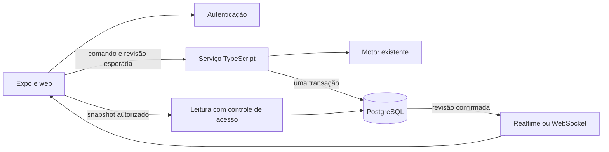

# Etapa 5 — arquitetura proposta para multiplayer

Status: **planejamento, sem backend implementado**. Revisão em 23/11/2026, após a auditoria da Etapa 4. Não foram criados projetos remotos, contas, tabelas, credenciais, funções, SDKs adicionais ou deploys. As escolhas abaixo são propostas reversíveis; devem ser confirmadas por uma prova transacional e testes de múltiplos clientes antes da implementação pública.

Continuidade: o parágrafo acima registra o estado deste plano quando foi escrito. A [Etapa 5A](stage-5a.md) implementou depois a fundação local, migrations e a prova transacional em PostgreSQL real. A [Etapa 5B](stage-5b.md), retomada em 24/11/2026, acrescentou Auth real local, sessão e perfis privados, com homologação nativa ainda pendente. Os torneios permanecem locais; projeto remoto, importação, convites e Realtime continuam pendentes. Este documento preserva a proposta das etapas futuras.

## Ponto de partida e regras preservadas

O aplicativo Expo SDK 58 usa Expo Router, Zustand e o envelope versão 1 da chave `matchmaking-local-v1`. O estado persistido contém `tournaments`, `profile` e `draft`; ações, hidratação e erros de armazenamento ficam fora dele. AsyncStorage atende Android/iOS; localStorage atende web. A proteção atual preserva dados inválidos e bloqueia novas gravações. Uma resposta remota vazia ou uma falha de autenticação nunca deverá substituir esse armazenamento.

O domínio está em `src/features/tournaments/domain/types.ts`; o motor puro está em `engine/tournament.ts`. Ele define capacidade 4/8/16, sorteio Fisher–Yates, partidas, progressão, desempate, correção, campeão e ranking. Uma troca de vencedor limpa somente os descendentes; manter o vencedor preserva os placares posteriores. Apelido não é identidade. O perfil local só associa jogadores explicitamente por `profileId`.

Os IDs atuais são strings (`cup-…`, `…-p1`, `…-r1-m1`), não UUIDs. O sufixo de participante pode ser reutilizado após uma remoção na preparação. Não converter esses valores por cast, nem tratá-los como identidade global ou credencial. O app não tem autenticação, propriedade remota, convites reais, sincronização ou backup.

## Comparação das alternativas

| Critério | A — Supabase | B — NestJS + PostgreSQL |
| --- | --- | --- |
| Implementação inicial | Auth, PostgreSQL, Data API, RLS e Realtime gerenciados reduzem a integração inicial; comandos do torneio ainda exigem validação transacional própria | API TypeScript própria, módulos e guards; exige construir/integrar identidade, convites, sincronização e operação |
| Regras do torneio | Serviço de comandos TypeScript reutiliza o motor; acesso direto de escrita à chave fica fechado | Serviços Nest reutilizam o mesmo motor; controllers e gateways chamam a mesma fronteira de comandos |
| Autenticação | Auth oferece contas e sessões anônimas; vinculação e recuperação precisam de fluxos explícitos | Autenticação personalizada com bibliotecas maduras: sessões/JWT, renovação, revogação, confirmação de e-mail e recuperação sob responsabilidade da equipe |
| Banco e acesso | RLS limita leituras por associação ao torneio; migrations, grants e índices continuam responsabilidade do projeto | Autorização por recurso nos serviços/guards; role de banco limitada e RLS podem complementar a defesa |
| Tempo real | Assinar mudanças de revisão do torneio; medir fan-out e custo de autorização | Gateways WebSocket; múltiplas instâncias exigem distribuição de eventos e coordenação de conexões |
| Escala | Serviço gerenciado, limites por plano e pool de conexões; medir comandos, assinantes e egress | Escalar API, WebSocket, pool e PostgreSQL separadamente; maior controle e carga operacional |
| Custos | Plano/compute, banco, conexões/mensagens Realtime, egress, funções, e-mail e recuperação | Hospedagem da API, banco, backups, balanceador, eventual broker, observabilidade, e-mail e horas de operação |
| Segurança e manutenção | Menos serviços operados; políticas e caminhos privilegiados incorretos ainda podem expor dados | Controle explícito, com maior responsabilidade por patches, segredos, disponibilidade, abuso e recuperação |
| Expo e web | Há integração oficial com Expo; adaptar armazenamento de sessão, AppState e redirecionamentos | HTTPS e WebSocket são compatíveis; construir os adaptadores e os mesmos fluxos de sessão/deep link |
| Migração local | Importação validada e idempotente; Auth/Realtime acrescentam dependência do provedor | A mesma importação; maior portabilidade da aplicação, com infraestrutura própria para manter |

As vantagens de prazo/manutenção são uma avaliação para este app pequeno, sem backend existente, e não um benchmark. Supabase documenta [integração com Expo](https://supabase.com/docs/guides/getting-started/tutorials/with-expo-react-native) e [RLS com grants e políticas](https://supabase.com/docs/guides/database/postgres/row-level-security). Nest oferece [autenticação](https://docs.nestjs.com/security/authentication), [autorização](https://docs.nestjs.com/security/authorization) e [gateways WebSocket](https://docs.nestjs.com/websockets/gateways); esses recursos não substituem as regras por torneio.

Não há estimativa mensal confiável sem volume. Antes de contratar, levantar usuários ativos, torneios/dia, espectadores simultâneos, comandos/s, tamanho dos snapshots, mensagens por assinante, retenção e objetivos de recuperação. Simular esses volumes na [tabela oficial de preços Supabase](https://supabase.com/pricing) e em uma cotação de API + PostgreSQL gerenciado para Nest, incluindo operação humana. O plano gratuito serve à experimentação; não assumir disponibilidade contínua ou recuperação de produção a custo zero.

## Recomendação e fronteira das regras

**Recomenda-se começar com Supabase Auth + PostgreSQL + RLS + Realtime, com um serviço TypeScript de comandos que reutilize o motor atual.** O objetivo é diminuir o trabalho de infraestrutura sem entregar a decisão de resultados ao cliente. A recomendação depende de provar uma transação real usando uma conexão PostgreSQL e o motor no runtime escolhido. A documentação permite [conectar funções a PostgreSQL por driver](https://supabase.com/docs/guides/functions/connect-to-postgres); isso não garante, por si só, a implementação correta de uma transação.

O cliente envia intenção (`record_result`, `correct_result`, `draw_bracket`, `add_participant` etc.), nunca um campeão ou chave arbitrários para sobrescrever. O servidor autentica, autoriza, carrega o agregado confirmado, executa o motor e persiste o resultado atomicamente. O cliente pode calcular prévias com o motor; só apresenta como confirmado o que o servidor aceitou. Animações recebem esse snapshot e não geram sorteios ou placares.

Na primeira prova, avaliar uma função gerenciada TypeScript com driver transacional, pooler e conexão exclusiva durante cada comando. Não combinar chamadas REST separadas esperando atomicidade. Se runtime, conexão, observabilidade ou manutenção não forem adequados, usar o mesmo serviço de comandos em NestJS. Essa mudança preserva o contrato e o PostgreSQL. Não portar o motor informalmente para SQL. Uma alternativa RPC SQL só poderá ser adotada após definir e testar equivalência com o domínio TypeScript.

Para Nest, Prisma é uma opção para esquema tipado, migrations e transações; o bloqueio do agregado pode exigir SQL parametrizado dentro da transação. Comparar com um driver PostgreSQL direto, que reduz camadas para comandos pequenos, mas exige SQL e mapeamento manuais. Confirmar a API da versão escolhida; a [documentação Prisma de transações](https://www.prisma.io/docs/orm/fundamentals/transactions) fundamenta a atomicidade, sem fixar versão ou instalar ORM agora.

## Modelo de dados proposto

Usar tabelas normalizadas como fonte canônica. Um adaptador reconstrói o `Tournament` completo para o motor e grava todas as mudanças na mesma transação. Snapshots de importação/backup são cópias imutáveis, não uma segunda fonte editável. Estados de rodada, campeão e estatísticas continuam derivados pelo motor; campos derivados usados em consultas são atualizados na mesma transação.

| Entidade | Campos e vínculos principais |
| --- | --- |
| `profiles` | `user_id` UUID da identidade autenticada, nickname, criação/atualização do servidor. Nunca usar o `profile.id` local como prova de propriedade |
| `tournaments` | `id` UUID remoto, `domain_id` textual, `owner_user_id`, nome, modalidade, capacidade, status, `revision`, `schema_version`, `rules_version`, `draw_order`, campeão e datas. `domain_id` permite preservar IDs importados |
| `tournament_members` | Torneio + usuário únicos, papel, data de entrada e remoção. Participação na sala não concede permissão para registrar placares |
| `participants` | Torneio + `domain_id` únicos, nome, posição da lista, vínculo opcional com usuário e data original. Nomes repetidos são permitidos |
| `rounds` | Torneio + `domain_id`, índice único por torneio, label e status derivado; ordem dos confrontos explícita |
| `matches` | Torneio + `domain_id`, rodada/posição únicas, participantes opcionais, `next_match_id`, status, placares inteiros não negativos, vencedor e revisão da alteração |
| `tournament_events` | ID, torneio, tipo, partida opcional, ator, comando, revisão, versão do motor e data do servidor. Resultados/correções incluem estado anterior/novo e descendentes invalidados; importação e sorteio também têm eventos imutáveis |
| `invites` | ID, torneio, digest do token/código, papel limitado, expiração, limite/usos, emissor e revogação. Segredo nunca enviado em leituras gerais |
| `command_receipts` | Torneio + ator + `command_id` únicos, versão, hash do payload e revisão/resposta confirmadas. Retentativas não reaplicam comandos |
| `imports` | Usuário, origem da instalação, `import_id` único no escopo, hash, versão original, ID remoto e snapshot original protegido. Permite retomar após interrupção |

Referências a participantes, vencedor, campeão e próxima partida devem incluir o torneio em FKs compostas ou validação equivalente; uma referência válida em outro torneio não é aceitável. Aplicar limites de payload, nomes e capacidade e a mesma validação de placares inteiros seguros do motor. Manter os IDs de domínio textuais em todas as referências de uma importação; UUID remoto e ID de domínio são campos distintos.

Novas entidades remotas precisam de IDs nunca reutilizados. Antes de habilitar adição remota, definir sob testes a injeção/mapeamento de IDs na fronteira do motor, preservando as regras e os IDs importados. Até lá, a revisão do agregado também impede que um comando antigo atinja um participante que reutilizou um sufixo local. Não reconstruir a identidade de jogadores removidos a partir de um snapshot que não tem esse histórico.

## Autenticação, convidados e permissões

Organizadores de torneios compartilhados devem ter credencial recuperável verificada. Começar com um método simples de e-mail e definir os redirecionamentos web/app antes de acrescentar provedores. Sessão autenticada identifica a pessoa; associação ao torneio determina o acesso. Refresh, logout, expiração, troca de conta e retorno por deep link precisam de testes Android/iOS/web.

Convidados podem receber uma sessão anônima autenticada e um `user_id` real. Isso difere da role pública `anon`. Perder a sessão anônima pode impedir recuperação; oferecer vinculação antes de depender do histórico em outros dispositivos. A conversão e os conflitos com contas existentes exigem fluxo explícito, sem transferir propriedade por coincidência de apelido/e-mail. Fontes: [acesso anônimo](https://supabase.com/docs/guides/auth/auth-anonymous) e [vinculação de identidades](https://supabase.com/docs/guides/auth/auth-identity-linking).

| Papel no MVP remoto | Permissões propostas |
| --- | --- |
| Organizador | Gerir preparação, sortear uma vez, registrar/corrigir resultados, gerir convites e acesso, excluir/exportar |
| Participante/convidado | Ler torneio admitido, associar sua entrada mediante confirmação e consultar resultados; não editar chave/placares |
| Espectador | Ler apenas o torneio autorizado |
| Anotador delegado | Possível evolução: resultados apenas, com delegação explícita; fora do primeiro MVP |

A entrada na conta não associa participantes por nome automaticamente. A reivindicação de um jogador existente exige confirmação do organizador. Só o organizador atual pode delegar ou transferir propriedade, com confirmação e auditoria. Revogar um convite não remove membros já admitidos; essa é uma operação separada.

Manter credenciais administrativas e conexão PostgreSQL somente no servidor. No app, URL e chave pública não concedem privilégios por si; RLS/grants devem fechar leituras indevidas e toda escrita direta de resultados, campeão, propriedade e papéis. Se uma conexão do serviço contornar RLS, ela precisa de autorização explícita por recurso. Preferir role limitada; claims usados na conexão devem ter escopo da transação para não vazar entre clientes do pool. Sessões devem ficar em adaptador apropriado à plataforma, separado dos torneios; AsyncStorage não é armazenamento criptografado. A escolha de SecureStore/armazenamento web precisa de revisão específica antes de implementar Auth.

## Convites por link, QR e código

O link HTTPS contém um token aleatório criptográfico de alta entropia; QR Code representa o mesmo link. Planejar abertura na web e encaminhamento ao app pelo esquema `matchmaking`, com App Links/Universal Links como configuração futura a validar em binário próprio. Não publicar agora um domínio ou prometer abertura instalada sem essa associação.

Guardar somente o digest do token, validade, papel concedido, limite de uso e revogação. Código curto usa expiração, limite de tentativas por origem/sessão, proteção de digest com segredo do servidor e erros que não enumerem torneios. Link/código nunca concede papel de organizador. Tokens não entram em logs, analytics, notificações de revisão ou snapshots públicos.

Abrir o link por GET apenas apresenta o convite: previews de mensageiros não podem consumir uma vaga. Após autenticar/criar sessão, um aceite explícito valida convite e capacidade, registra membership e uso na mesma transação. Bloquear torneio e convite em ordem consistente evita ultrapassar o último uso. Definir se a admissão pede um novo participante ou somente acesso; somente a primeira consome vaga competitiva. Depois do sorteio, convidar para visualizar não altera os participantes.

## Concorrência, correção e idempotência

Contrato proposto: `commandId`, `commandVersion`, `tournamentId`, `expectedRevision`, tipo e payload. Autor vem do token validado, nunca do payload. Usar HTTPS e verificar assinatura, emissor, audiência e expiração da sessão.

Cada comando deve executar em uma única conexão/transação:

1. Bloquear a linha do torneio com `SELECT … FOR UPDATE`; validar acesso atual. Todos os escritores, incluindo membros, exclusão e administração, seguem esse protocolo.
2. Consultar recibo do mesmo ator/comando. Se hash e versão coincidirem, retornar a resposta já confirmada **antes** de verificar revisão. Se a chave foi reutilizada com outro payload, rejeitar.
3. Para um comando novo, comparar `expectedRevision`. Se divergir, retornar conflito (`409` na API HTTP) e revisão atual autorizada, sem alteração.
4. Reconstruir o agregado bloqueado e executar o motor. Sorteio usa RNG do servidor, injetado no motor existente; gerar uma ordem uma única vez e armazená-la.
5. Persistir resultado, avanço, invalidação dos descendentes, estados de rodadas e campeão atomicamente. Manter o vencedor preserva descendentes, como hoje.
6. Incrementar revisão; gravar evento e recibo com hash do comando normalizado, incluindo revisão esperada. Confirmar a transação antes de responder/notificar.

Com dois clientes na revisão 12, apenas um comando novo confirma a revisão 13; o outro recebe conflito. A UI busca o snapshot atual e pede nova revisão/confirmação da intenção, principalmente quando uma correção limparia resultados. Não reenviar automaticamente a correção sobre dados novos.

O [bloqueio de linhas PostgreSQL](https://www.postgresql.org/docs/current/explicit-locking.html#LOCKING-ROWS) sustenta a exclusão entre escritores do mesmo agregado. Ele só funciona se todos respeitarem a fronteira. Definir timeout de lock/operação, ordem dos locks e retentativa limitada de deadlock; não fazer requisições externas segurando locks. Torneios distintos não devem disputar um lock global.

Se a rede cair durante o commit, repetir **o mesmo `commandId` e payload** ou consultar seu recibo; gerar outra chave pode duplicar a intenção. Revalidar acesso antes de devolver recibos privados. A proposta inicial registra recibos de comandos aplicados; rejeições não alteram estado. Isso oferece aplicação única por chave, não garantia de entrega de rede exatamente uma vez. Definir retenção de recibos e tratamento de comandos antigos antes de liberar clientes offline.

## Tempo real, histórico e uso offline

Assinar revisões confirmadas de torneios aos quais o usuário tem acesso. A notificação significa “há estado novo”; não é um comando nem árbitro de concorrência. Buscar snapshot coerente em uma leitura transacional/endpoint, ignorar respostas de revisão menor e refazer leitura ao reconectar, retomar do background ou detectar lacuna. Evitar montar um torneio misturando leituras de tabelas de revisões diferentes.

Para Supabase, começar medindo Postgres Changes na linha de revisão, com RLS e índices de associação; para grande fan-out, avaliar Broadcast privado. A documentação descreve [custo de autorização por assinante](https://supabase.com/docs/guides/realtime/postgres-changes#scaling-postgres-changes) e [autorização de canais Broadcast/Presence](https://supabase.com/docs/guides/realtime/authorization). Para Nest, distribuir apenas eventos posteriores ao commit; uma outbox transacional é opção para não perder a publicação após uma falha. Em ambos, desconectar assinaturas no logout e remover dados remotos do cache da conta anterior sem apagar os torneios locais independentes.

O histórico consulta torneios admitidos/organizados e eventos de resultado paginados. Estatísticas continuam calculadas pelo motor; agregar entre torneios somente quando o mesmo usuário foi explicitamente vinculado. Uma importação começa com evento de importação: não inventar quem registrou placares passados ou uma sequência de eventos que o armazenamento local nunca guardou.

No primeiro MVP remoto, confirmação de sorteio e placares exige conexão. Offline permite leitura do último snapshot e rascunho de intenção, identificado como pendente, sem campeão confirmado por escrita otimista. Ao reconectar, verificar revisão antes de reenviar. Torneios estritamente locais seguem funcionando como hoje.

## Migração local sem perda

1. Manter o envelope v1 e suas proteções. Dados inválidos/bloqueados não se tornam uma importação vazia. Não hidratar o store local com uma lista remota vazia.
2. Oferecer “Enviar este campeonato para minha conta”, com prévia e organizador recuperável autenticado. `profile.id` local é metadado, não prova de ownership.
3. Persistir em metadados separados uma origem da instalação e um `importId` antes do primeiro envio, sem alterar silenciosamente o esquema v1. Guardar hash do snapshot escolhido.
4. Validar capacidade, IDs, topologia, referências, placares, ordem sorteada e campeão no servidor; reusar/adaptar as validações do domínio. Importar todas as entidades e recibo em uma transação idempotente. Datas originais são históricas; `imported_at` operacional vem do servidor.
5. Preservar `drawOrder` e resultados. Não chamar um novo sorteio para reconstruir um torneio ativo/concluído. Mapear coerentemente todas as referências caso haja novos IDs remotos.
6. Ler a cópia remota confirmada e comparar participantes, ordem, partidas, placares, campeão e versão. Só então registrar a associação local/remota.
7. Manter a cópia local e permitir exportação. Importação repetida com mesmo hash retorna o mesmo torneio, inclusive após crash. Conteúdo alterado exige comando com revisão ou escolha explícita de importar como outra cópia.

Identificadores legados iguais em instalações diferentes não podem colidir: unicidade por usuário/origem/importação e UUID remoto. Não sincronizar dois torneios pelo nome. Vínculos com contas precisam de consentimento/confirmação; nenhuma importação reivindica automaticamente dados de outro usuário. Falha de rede, escrita ou comparação preserva o original.

## Backup, recuperação e segurança operacional

Planejar exportação versionada por torneio/conta e ensaiar restauração em ambiente isolado. Definir RPO/RTO antes de escolher o plano; proposta inicial a validar: perda máxima de 24 h e recuperação em até um dia útil, com PITR se o produto exigir menos. A [documentação de backups Supabase](https://supabase.com/docs/guides/platform/backups) diferencia backups diários nos planos pagos, exportação no gratuito e PITR adicional. No Nest, contratar/configurar a mesma capacidade no provedor PostgreSQL. Backup do banco não substitui o tratamento de arquivos externos ou recuperação da conta.

Criptografar transporte e backups, restringir operadores, testar isolamento por torneio e minimizar dados pessoais. Logs devem registrar IDs de comando/revisão, latência e falhas, sem tokens, códigos, sessões ou payloads pessoais completos. Definir retenção, exclusão, auditoria e restauração; evento de resultado não deve virar cópia permanente de dados pessoais sem necessidade.

Revogar membro impede novas leituras/comandos/assinaturas, mas não apaga dados já recebidos. Restaurar um backup também exige invalidar/reconciliar caches, recibos e intenções locais: uma revisão pode retroceder. Prever um identificador de época da restauração e obrigar nova leitura, impedindo comandos da época anterior. Recuperação deve ser ensaiada, não apenas configurada.

## Sequência de implementação e critérios de saída

1. Homologar o fluxo atual no Galaxy S25 Ultra e em iOS conforme a Etapa 4. Registrar teclado, gestos, persistência real, fonte ampliada e desempenho; um aparelho topo de linha não comprova desempenho intermediário.
2. Aprovar contrato, ownership, papéis, modelo e política de recuperação/custo. Provar motor + runtime + conexão/pooler + transação com rollback, ainda sem usuários externos.
3. Implementar identidade/perfis e leitura isolada; testes de RLS/grants e do caminho privilegiado antes de convites.
4. Implementar comandos e importação idempotentes; depois convites/link/código/QR, tempo real e reconexão. Liberar gradualmente após dois clientes concorrentes convergirem.

Testes obrigatórios para a Etapa 5, **ainda não executados porque não existe backend**:

- Fixtures reais 4/8/16, desempate, correção com mesmo/outro vencedor, campeão e estatísticas: serviço e motor produzem o mesmo agregado.
- Mesma revisão disputada: um comando aplica e outro conflita, sem descendentes parciais; torneios diferentes permanecem independentes.
- Falha entre placar e campeão: rollback integral de estado/evento/recibo. Timeout no commit: repetição retorna a mesma aplicação; chave com payload diferente é rejeitada.
- Escrita direta, viewer, usuário externo e membro removido: acesso negado por API e banco. Token expirado e troca de conta não expõem cache anterior.
- Último uso de convite disputado, expiração/revogação, brute force e preview GET: nenhuma admissão/consumo extra.
- Importação interrompida antes/depois do commit e IDs iguais em instalações distintas: sem perda ou duplicação; snapshot inválido e referências cruzadas são rejeitados.
- Eventos fora de ordem, desconexão e retomada: convergência ao snapshot autorizado. Comando antigo não atinge participante com sufixo local reutilizado.
- Restauração real de backup, reconciliação de época/revisões e recuperação de conta. Medir latência de comandos, pool, assinantes, egress e custo com a carga escolhida.

O runtime do serviço, plano/região, domínio de convites, provedor de e-mail, retenção e metas de carga continuam abertos. Nenhuma dessas decisões foi aplicada ao aplicativo nesta etapa.
