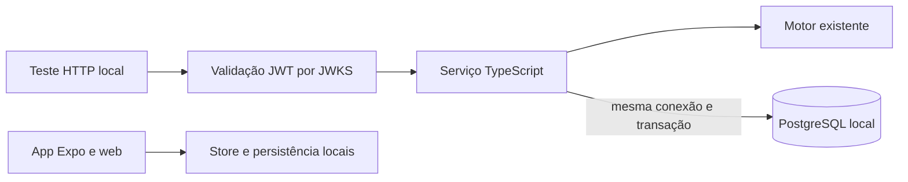

# Etapa 5A — fundação do backend e prova transacional

Entrega em 23/11/2026: **fundação local implementada e comprovada em PostgreSQL real**. O aplicativo continua local e não está conectado ao serviço. Não foram criados projeto remoto, conta, credencial de produção, deploy, login visual, convites, QR Code, Realtime ou NestJS.

## Estado inicial e preservação

A inspeção começou em `ff008a1`, na branch `main`, limpa e sincronizada com `origin/main`. Foram examinados os últimos 20 commits, README, Etapas 4/5, domínio, motor, Zustand e persistência. TypeScript, ESLint e os **92 testes Jest em 16 suítes** passaram antes das alterações; a exportação web e os **52 casos Playwright** existentes também passaram na base.

O motor `src/features/tournaments/engine/tournament.ts` foi reutilizado sem alteração. A validação estrutural de um torneio foi extraída do store para `domain/validation.ts`, sem mudar suas regras, permitindo uso no servidor sem React, Expo ou Zustand. O store mantém a validação do envelope/perfil/rascunho e de IDs únicos entre torneios. A chave `matchmaking-local-v1`, versão 1, hidratação, bloqueio de gravação de dados inválidos e ações foram preservadas. Nenhum adaptador remoto foi conectado ao app; faltas de configuração ou de sessão do backend não alcançam seus torneios locais.

## Ambiente e arquitetura executados

Windows, PowerShell, Node **24.22.1**, Docker Desktop e Supabase CLI **3.3.0**, instalada como dependência de desenvolvimento com versão fixa. Docker estava instalado, mas parado; foi iniciado. `supabase db start` iniciou o PostgreSQL local **17.12.0.002** em `127.0.0.1:54322`. `supabase migration up --local` aplicou as três migrations. Não houve `login`, `link`, `db reset`, acesso a projeto remoto ou migração em produção.

O `supabase/config.toml` define PostgreSQL 17 e expõe somente `public` na configuração da Data API, com exposição automática de novas tabelas desativada. Pooler, Realtime, Studio, Storage, Analytics e Edge Runtime estão desativados. Nesta prova foi iniciado **somente o banco**, não a stack completa de Auth/Data API. A CLI preparou o catálogo Auth do banco; isso não representa um fluxo de autenticação executado.

O serviço roda em **Node 24**, com `pg` **8.23.1**, `jose` **6.2.18** e build ESM por esbuild. As ferramentas ficam nas devDependencies da raiz; `backend/package.json` marca o módulo como privado e ESM. O empacotamento de um servidor de produção independente ainda não foi realizado. As dependências de runtime do aplicativo Expo não foram alteradas.



`auth.ts`, `commands.ts`, `service.ts` e `repository.ts` são independentes do servidor HTTP. Um controller NestJS futuro pode chamar a mesma fronteira; não há segunda implementação das regras nem port do motor para SQL. A prova escolhe Node com conexão PostgreSQL direta, em vez de presumir que o runtime Edge e seu pooler já funcionem.

### Driver e pooler

Todas as consultas entre `BEGIN` e `COMMIT`/`ROLLBACK` usam o **mesmo client obtido de `pool.connect()`**, aguardadas em sequência, sem `pool.query()` na transação, pipelining ou prepared statements nomeados. A escolha segue a [documentação de transações do node-postgres](https://node-postgres.com/features/transactions). A [documentação de conexão Supabase](https://supabase.com/docs/guides/database/connecting-to-postgres) descreve limitações de prepared statements e pipelining no modo transacional. O pooler local está desativado: **Supavisor remoto, TLS, limites de conexão e execução Edge não foram testados**. Devem ser provados no destino antes de usar esse serviço fora do ambiente local.

## Modelo e migrations

As tabelas relacionais são a fonte canônica. O repositório reconstrói o `Tournament`, valida sua estrutura e grava resultados derivados na mesma transação. UUID remoto e ID textual de domínio são campos distintos; IDs legados não são convertidos em UUID. Dois torneios podem preservar os mesmos IDs de domínio sem colidir.

| Entidade | Fundação implementada |
| --- | --- |
| `public.profiles` | `user_id` ligado a `auth.users`, nickname e criação; sem cadastro/perfil remoto na interface |
| `public.tournaments` | UUID, `domain_id`, proprietário, capacidade 4/8/16, status, revisão, versões, ordem, campeão e datas |
| `public.tournament_members` | Associação única por torneio/usuário, participante ou espectador; não concede escrita de resultado |
| `public.participants` | Chave por torneio/ID textual, nomes repetidos permitidos e posição única por torneio; `profile_id` textual preserva metadado local sem conceder autoridade |
| `public.rounds` | ID textual, índice único por torneio, label e estado derivado |
| `public.matches` | Rodada/posição, participantes, placares, vencedor e próxima partida com referências compostas por torneio |
| `matchmaking_private.tournament_events` | Evento por revisão com ator, comando, versão do motor, antes/depois e descendentes invalidados |
| `matchmaking_private.command_receipts` | Chave torneio/ator/comando, versão, hash, revisão e resposta histórica imutável para repetição |

Há FKs compostas para participantes, vencedor, campeão, rodada e próxima partida; unicidade de posições; ausência de auto referência; checks de capacidade, status e placares/revisões inteiros seguros não negativos. A topologia completa e a progressão são validadas pelo domínio. Datas operacionais usam defaults do banco e `updated_at` usa `clock_timestamp()`; datas de domínio geradas pelo motor são persistidas. Eventos e recibos têm somente leitura/inserção para o serviço: sua resposta histórica não é usada para reconstruir o estado atual. Não existe uma segunda cópia canônica editável em JSON.

Migrations, em ordem:

1. `20261123000100_tournament_foundation.sql`: entidades, integridade e role sem login `matchmaking_command`.
2. `20261123000200_access_policies.sql`: RLS, grants por coluna e políticas de leitura/serviço.
3. `20261123000300_installer_command_role.sql`: permite ao instalador confiável assumir a role; não concede esse poder às roles clientes. Necessária porque o `postgres` local do Supabase não é superusuário.

Invites e imports terão migrations e fronteiras próprias nas próximas etapas. Ainda não existe endpoint para criar/importar campeonatos: fixtures administrativas são usadas apenas nos testes. A adição remota de participantes deverá resolver os IDs nunca reutilizados descritos na arquitetura antes de ser habilitada.

## Segurança e autenticação da prova

RLS está habilitada nas oito tabelas. `anon` não lê torneios; `authenticated` só lê torneios próprios/admitidos e seu próprio perfil. As roles clientes não têm escrita nas tabelas: resultados, campeão, propriedade, membros e estrutura não podem ser alterados diretamente. `service_role` também não recebe grants dessas tabelas. O schema privado não é exposto pela Data API.

A única função `SECURITY DEFINER`, `can_read_tournament`, consulta propriedade/associação, usa nomes qualificados e `search_path = ''`, sem SQL dinâmico. O proprietário da função pode ler as tabelas para evitar recursão de RLS; sua execução foi removida de `PUBLIC`/`anon` e concedida apenas a `authenticated`. Esse acesso ao schema privado não concede acesso às tabelas privadas. O banco deve ser instalado por um operador confiável; mudar o proprietário dessa função exige nova revisão.

O serviço usa um login separado, **NOINHERIT, NOSUPERUSER e NOBYPASSRLS**, com permissão explícita de `SET ROLE matchmaking_command`. Dentro da transação usa `SET LOCAL ROLE`, revertido ao final. Essa role só lê o agregado, atualiza colunas de resultado/estado e insere eventos/recibos; não pode criar estrutura, gerir membros ou trocar ownership. Suas políticas permitem tratar vários torneios: a autorização explícita por proprietário no serviço continua obrigatória. A credencial desse login é exclusivamente do servidor.

O HTTP só aceita `POST /commands`, em loopback, corpo até 16 KiB e resposta `no-store`. O ator vem de Bearer JWT validado por JWKS com `jose`: assinatura ES256/RS256, emissor configurado, audiência `authenticated`, `sub` UUID, `exp`, `iat`, role autenticada, idade máxima de uma hora e tolerância de cinco segundos. HTTPS é obrigatório para o emissor fora de loopback. Falhas retornam 401; o payload não pode fornecer ator ou papel.

Não há fallback HS256. Um Auth local/projeto que emita somente HS256 será recusado: a Etapa 5B deve configurar chaves assimétricas ou implementar a verificação pelo servidor Auth recomendada na [documentação JWT do Supabase](https://supabase.com/docs/guides/auth/jwts). O teste HTTP usa chaves efêmeras e um JWKS local real; **não comprova login, refresh, logout, revogação, recuperação de conta ou GoTrue completo**. A verificação atual é criptográfica e não consulta revogação de sessão.

## Contrato e transação

Exemplo fictício, com IDs remotos diferentes do ID da partida:

```json
{
  "commandId": "11111111-1111-4111-8111-111111111111",
  "commandVersion": 1,
  "tournamentId": "22222222-2222-4222-8222-222222222222",
  "expectedRevision": 12,
  "type": "record_result",
  "payload": { "matchId": "cup-exemplo-r1-m1", "score1": 3, "score2": 1 }
}
```

`record_result` exige partida ainda não concluída; `correct_result` exige resultado existente. Empate exige `tieBreakWinnerId` pertencente ao confronto. Inteiros negativos, fracionários ou inseguros, versão desconhecida e campos extras são recusados. Os tipos de `add_participant`, `remove_participant` e `draw_bracket` estão reservados, mas o endpoint os rejeita nesta etapa.

Cada execução:

1. Autentica e valida o contrato antes de adquirir uma conexão.
2. Inicia transação, assume role local, aplica timeout de lock de 3 s e de statement de 5 s e bloqueia a linha do torneio com `FOR UPDATE`.
3. Autoriza o proprietário atual; torneio inexistente e usuário sem acesso recebem o mesmo 403. Verifica as versões do agregado.
4. Procura recibo do mesmo ator/comando **antes** de comparar a revisão. Versão/hash iguais retornam a resposta confirmada; payload diferente retorna 409.
5. Para comando novo, compara `expectedRevision`; divergência retorna `REVISION_CONFLICT`/409 sem alteração.
6. Reconstrói o agregado, executa `recordResult` do motor e valida o resultado. Correção com mesmo vencedor preserva descendentes; outro vencedor invalida só seu caminho e remove campeão quando necessário.
7. Grava partidas, rodadas, estado/campeão, revisão incrementada, evento e recibo na mesma transação. Só responde após `COMMIT`.

Qualquer falha causa rollback; falha no rollback descarta a conexão. Timeout de lock/statement, deadlock e serialização retornam `RETRY_SAME_COMMAND`/409, sem reexecução automática. Não há requisição externa enquanto o lock está aberto. Todo escritor futuro de propriedade, associação ou estrutura deverá respeitar o mesmo lock do agregado.

Com dois comandos novos na revisão 12, um confirma a 13 e o outro conflita. O cliente futuro deve reler e pedir confirmação da intenção; não reaplicar uma correção automaticamente. Após perder a resposta de um commit, repetir **mesmo ID e payload** retorna a aplicação original. O hash SHA-256 usa representação normalizada do comando completo, incluindo versão e revisão esperada. O acesso é revalidado antes de devolver recibos privados.

O recibo pode conter uma revisão anterior à atual: ele confirma aquela operação, não substitui o snapshot mais recente do cliente. Retenção, exclusão, restauração/época e reconciliação offline ainda precisam de política antes do uso público. A garantia é uma aplicação por chave, não entrega de rede exatamente uma vez.

## Validação executada

| Verificação | Resultado final |
| --- | --- |
| TypeScript app e backend | Aprovados em configurações separadas e strict |
| ESLint | Aprovado; build gerado ignorado |
| Jest / RNTL do app | **92 testes / 16 suítes**, preservados e aprovados após extração da validação |
| Playwright | **52 casos aprovados** na base e novamente com o código final do app, nas quatro larguras existentes |
| Unitários Node | **3 testes aprovados**, com matriz de contrato/hash e JWT válido/inválido |
| Integração PostgreSQL | **13 testes aprovados**, sem mocks de transação/locks/RLS |
| Migrations e asserts SQL | Aplicadas no banco Supabase local e novamente no banco descartável; asserts aprovados |
| Build backend / export web | Aprovados com código final |
| Expo dependency check | `Dependencies are up to date` |
| Android / iOS | Bundles Hermes finais exportados; sem aparelho/emulador, APK/IPA ou homologação nativa |
| Auditoria npm | 22 alertas moderados, zero altos/críticos; sem correção forçada |

Os 13 testes de banco abrangem HTTP compilado → JWT/JWKS → PostgreSQL com login restrito; flags/permissões do login e restauração da role; torneios completos 4/8/16 com reconstrução, campeão, ranking e estatísticas; correções; desempate; recibo após resposta perdida e avanço posterior de revisão; colisão de payload; mudança de proprietário; dois clientes realmente bloqueados na revisão 12; torneios independentes com IDs legados iguais; falha injetada depois de gravar o agregado com rollback de partidas/campeão/revisão/evento/recibo; leitura RLS e escrita negada para organizador, participante, espectador e externo; e constraints de referências/placares/capacidade/revisão.

`backend:test:db` cria um banco novo `mm_5a_test_<aleatório>` e um login temporário `mm_5a_role_<aleatório>`, aplica as migrations e os asserts e remove somente os recursos criados por aquela execução. Recusa DSN remoto e parâmetros de conexão que poderiam trocar o destino. O bootstrap desse banco implementa apenas o catálogo mínimo `auth.users`/`auth.uid()` para fixtures e claims de RLS; não simula as tabelas, transações ou locks do domínio. Os testes alternam roles reais do PostgreSQL. O serviço usa conexão restrita separada do administrador que prepara as fixtures. Senha temporária fica em memória e não é impressa.

A inspeção final confirmou três migrations no PostgreSQL local e zero bancos/logins temporários remanescentes da suíte.

Falhas encontradas e corrigidas: permissão de cache/execução da CLI e do build na sandbox, configuração ESM do runner TypeScript, falta de autorização do instalador para assumir a role e lint sobre artefato gerado. O teste HTTP completo revelou que o status 200 era enviado antes do `await` do comando; a resposta agora só começa após sua conclusão e erros retornam o status correto. Limite de corpo e rejeição de ator no payload também foram exercitados. Não foram removidos testes para obter aprovação. As repetições necessárias passaram; não há falha remanescente nesses comandos.

A auditoria não apontou alertas diretos nas novas ferramentas `pg`, `jose`, Supabase CLI, tsx, esbuild e tipos adicionados; isso não é garantia de segurança. Permanecem alertas transitivos do conjunto instalado, que devem ser revisados antes de publicação sem quebrar a compatibilidade Expo. Artefatos web/nativos e traces estão em diretórios ignorados.

## Executar localmente

Requisitos: Node 24, Docker Desktop em execução e portas locais livres. A [documentação da CLI Supabase](https://supabase.com/docs/guides/local-development/cli/getting-started) orienta instalação e desenvolvimento local. Os comandos abaixo não vinculam projeto remoto:

```powershell
npm.cmd ci
docker info
npm.cmd run db:start
npm.cmd run db:migrate
Copy-Item backend/.env.example backend/.env
```

Edite somente o arquivo ignorado `backend/.env`, substituindo `REPLACE_ME`. Para testes, `MATCHMAKING_TEST_DATABASE_URL` deve apontar ao PostgreSQL **local** com um operador autorizado a criar banco/role. Consulte os dados locais pela CLI (`npx.cmd supabase status --output env`) sem copiá-los para código, Git ou variáveis `EXPO_PUBLIC_`. Não use credencial de produção. O runner nunca usa `DATABASE_URL` como destino dos testes.

```powershell
npm.cmd run backend:typecheck
npm.cmd run backend:test
npm.cmd run backend:test:db
```

O último comando compila o serviço automaticamente e executa os 13 testes no banco descartável; não usa `db reset`. A ausência do banco/DSN causa falha explícita, sem anunciar aprovação. Não é necessário executar servidor Auth nem criar contas para essa suíte. Em interrupção forçada do processo, a limpeza final pode não executar: inspecione os nomes antes de remover qualquer recurso remanescente; não apague um banco existente por padrão.

Para iniciar o HTTP manualmente, um operador deve provisionar um **login exclusivo do servidor**, configurar sua senha fora do código e conceder os privilégios abaixo. Essa configuração persistente não foi executada na entrega; a suíte usa um login temporário removido ao terminar.

```sql
CREATE ROLE matchmaking_service LOGIN NOINHERIT NOSUPERUSER NOBYPASSRLS;
-- No psql, defina a senha interativamente com: \password matchmaking_service
GRANT CONNECT ON DATABASE postgres TO matchmaking_service;
GRANT matchmaking_command TO matchmaking_service
  WITH ADMIN FALSE, INHERIT FALSE, SET TRUE;
```

Configure `DATABASE_URL` com esse login e `SUPABASE_AUTH_URL` com o emissor assimétrico realmente disponível. O endereço fictício do exemplo não inicia Auth: `db:start` inicia somente o PostgreSQL. Sem um emissor compatível, chamadas autenticadas serão recusadas. Fixtures não são uma API pública de criação de torneio.

```powershell
npm.cmd run backend:dev
# Alternativa compilada:
npm.cmd run backend:build
node --env-file=backend/.env backend/dist/server.mjs
```

O servidor abre em `127.0.0.1:8090`, sem CORS ou exposição pública. Segredos são exclusivamente do servidor; o app não lê esses arquivos. Para regressões do app, permanecem `typecheck`, `lint`, `test`, `build:web`, `test:e2e` e `check:deps`. Export nativo: `npx.cmd expo export --platform android --platform ios --output-dir .artifacts/stage5a-native`.

## Arquivos e commits

Criados: `backend/src/{auth,commands,repository,service,server}.ts`, `backend/test/{commands.test,database.integration,fixtures,run-database}.ts`, exemplos/configuração backend, `supabase/config.toml`, três migrations, dois arquivos SQL de teste, `tsconfig.backend.json`, `domain/validation.ts` e este relatório. Modificados: `package.json`/lockfile, ignores, `tsconfig.json`, configuração ESLint, import/validação do store, README e nota de continuidade da arquitetura.

| Commit | Conteúdo |
| --- | --- |
| `f265f5b` | `chore(backend): initialize local Supabase and Node tooling` |
| `8e29231` | `feat(database): enforce tournament integrity and private access` |
| `c17f647` | `feat(backend): implement atomic result commands with concurrency tests` |
| Commit final | Documentação da entrega; hash registrado na resposta final e em `git log` |

Stage seletivo, sem incluir segredos, caches, builds ou traces. Autor existente no histórico reutilizado por comando, sem editar configuração Git. Sem reset, amend, force push, push ou deploy. O estado da Etapa 4 documentado antes desta entrega é histórico; a base encontrada aqui já estava no remoto.

## Critérios e próxima etapa

Todos os critérios da fundação 5A foram verificados: ambiente local, migrations, integridade, RLS/grants, negativas de acesso, motor compartilhado, resultado/correção atômicos, concorrência, idempotência, rollback real, regressões, builds, commits e documentação. Isso não equivale a disponibilizar multiplayer no aplicativo.

Permanecem pendentes: Auth real e perfis recuperáveis, criação/leitura remota por API, importação e backup, política de recibos/dados pessoais, TLS e deploy, rate limiting/abuso, revogação de sessão, pooler remoto, carga/custo e observabilidade de produção. Não foram executados fluxos com dois aparelhos, TalkBack/VoiceOver, Safari/Firefox ou homologação nativa; as pendências da Etapa 4 continuam válidas.

**Etapa 5B:** implementar identidade/autenticação e perfis persistentes, validando chaves, sessão, refresh/logout/recuperação, armazenamento por plataforma, deep links e troca de conta com isolamento de cache. Preservar o store local e testar essas fronteiras antes de conectar o produto ao remoto. Depois: **5C** campeonatos remotos/importação idempotente, **5D** convites/link/QR/código, **5E** sincronização e multiplayer. Nenhuma dessas entregas foi antecipada.
