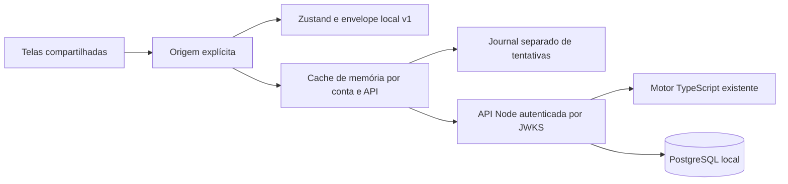

# Etapa 5C — campeonatos na conta e importação segura

Entrega local em **24/11/2026**. O aplicativo oferece campeonatos **Neste dispositivo**, independentes de login/internet, e **Na nuvem**, canônicos no PostgreSQL e operados pela API autenticada. “Na nuvem” identifica a origem remota; nesta prova o servidor roda no computador de desenvolvimento. Não houve projeto Supabase remoto, push, deploy, cobrança ou publicação.

**Etapa 5C concluída e comprovada localmente:** 84 casos de navegador, 140 testes Jest e 24 testes PostgreSQL aprovados, além das suítes Node/Auth e builds. A homologação em aparelhos e a operação pública permanecem pendentes.

## Auditoria e preservação

A base encontrada foi `main`, em `e28c718`, limpa, 11 commits à frente de `origin/main`. Antes da primeira edição foram executados `git status`, branch, últimos 20 commits, diffs normal/cached e arquivos não rastreados. Não havia trabalho 5C iniciado. Foram lidos README, relatórios 5A/5B, arquitetura, migrations, motor/domínio, store/persistência, Auth, API de comandos, Home, Torneios, Perfil e componentes reutilizados. Não havia instrução AGENTS adicional no workspace.

Já funcionavam criação local em três etapas, participantes, sorteio 4/8/16, chaveamento, resultados/correções, campeão/ranking, hidratação protegida e Auth real com perfis privados. A base passou novamente em TypeScript app/backend, lint, **124 Jest/21 suítes**, **16 PostgreSQL**, **3 Node** e **7 subtestes Auth + pai**. Esses resultados foram executados, não inferidos do relatório anterior.

`src/store`, motor `engine/tournament.ts`, tipos de domínio, envelope `matchmaking-local-v1`/versão 1, perfil local, tokens visuais e logo foram preservados. Nenhum snapshot remoto entra no Zustand local. Lista vazia, logout, troca de conta e erro remoto não apagam torneios locais. A confirmação de uma criação limpa seu rascunho como no fluxo anterior; login/retomada preservam o rascunho, e importação não o altera.

Não foram reinstalados Expo/Supabase, atualizadas dependências, removidos volumes, resetado o banco ou modificados firewall/credenciais existentes. Auth/Docker locais já disponíveis foram iniciados/preservados pelo tooling existente. O `.env.local` e a chave privada ignorados permanecem preservados.

## Arquitetura implementada



`useTournament` adapta leitura e ações à origem. Lobby, Bracket, Match, Stats, Champion, TournamentCard/Tabs, MatchReveal e ChampionReveal permanecem compartilhados. A rota usa UUID remoto com `source=cloud`; `Tournament.id` continua textual no snapshot. A navegação preserva a origem, inclusive em partidas e abas. As chaves de cards incluem origem, evitando colisão entre UUID e ID local.

`RemoteTournamentProvider` cria uma instância de `RemoteTournaments` por identidade verificada e URL da API. Renovar o token atualiza o transporte sem perder o cache. Logout/troca de conta abortam requisições, retiram listeners e limpam memória; a nova conta recebe instância vazia. Respostas antigas não publicam na nova instância. A remontagem de efeitos do React também foi testada. Nenhuma associação remota é reconstruída por apelido ou pelo `profileId` textual importado.

O cache contém resumos paginados e detalhes sob demanda. Leituras iguais pendentes são deduplicadas; uma lista iniciada antes de um commit não substitui resumos novos. Recibos históricos não fazem uma revisão menor regredir o snapshot. São tratados loading, success, error, unauthorized, conflict, offline e refreshing.

## Contratos HTTP

Todos os endpoints de dados exigem Bearer JWT validado antes de abrir conexão PostgreSQL. O ator vem exclusivamente do JWT. Campos extras, versões desconhecidas e payloads de ownership/role são recusados. Respostas JSON usam `Cache-Control: no-store`.

| Operação | Contrato |
| --- | --- |
| `POST /tournaments` | `commandId`, `commandVersion: 1`, `type: create_tournament`; payload `name`, `modality`, `capacity: 4/8/16`, `format: single_elimination` |
| `GET /tournaments?limit=20&cursor=…` | Lista própria; limite 1–50, padrão 20; `items` com UUID, nome, modalidade, capacidade/status, revisão, contagens, campeão e datas; `nextCursor` opcional |
| `GET /tournaments/:uuid` | Snapshot, revisão, ranking e estatísticas; proprietário ou associação explícita existente pode ler |
| `POST /commands` | Contrato 5A com `tournamentId` UUID e `expectedRevision`; adicionados `add_participant {displayName}`, `remove_participant {participantId}` e `draw_bracket {}`; mantidos `record_result`/`correct_result` |
| `POST /tournament-imports` | `commandId`, versão 1, `type: import_tournament`; payload `installationId`, `importId`, `snapshotVersion: 1`, `snapshot` |

Exemplo fictício de criação:

```json
{
  "commandId": "11111111-1111-4111-8111-111111111111",
  "commandVersion": 1,
  "type": "create_tournament",
  "payload": {
    "name": "Copa dos amigos",
    "modality": "Futebol",
    "capacity": 8,
    "format": "single_elimination"
  }
}
```

Criação/importação começam na revisão **1**, com evento inicial e recibo privado. Resultados usam o contrato e os recibos da 5A. Comandos têm limite HTTP de 16 KiB; importação tem 256 KiB, além dos limites estruturais 16 participantes/15 partidas/4 rodadas. Entradas de nome/modalidade/participante mantêm o limite de 80 unidades UTF-16 do motor; a transferência aceita nomes legados com até 80 pontos de código. IDs textuais têm limite de 200 pontos de código. Datas de transferência usam ISO UTC canônico, anos 0001–9999, com coerência entre criação, participantes, início e conclusão. Placares e sua soma devem permanecer inteiros seguros, para evitar estatísticas com perda de precisão.

Erros relevantes: 401 de autenticação; 403 uniforme para torneio inexistente/sem acesso; 400 de contrato/snapshot; 422 de domínio/agregado; 409 `REVISION_CONFLICT`, `IDEMPOTENCY_KEY_REUSED`, `IMPORT_CONTENT_CHANGED` ou `RETRY_SAME_COMMAND`. O cliente não reaplica uma intenção conflitante automaticamente.

## Migrations, autorização e IDs

Aplicada **`20261124000500_cloud_tournaments.sql`**, além das quatro migrations preservadas:

- Amplia tipos de evento e cria índice de paginação por proprietário/atualização/UUID.
- Acrescenta `matchmaking_private.operation_receipts`, para operações anteriores à existência do torneio, e `tournament_imports`, com ator/origem/importação/hash/UUID/estado confirmado e resposta histórica.
- Acrescenta `participant_ids`, com reserva permanente por torneio/ID e backfill dos participantes existentes. Não recebe UPDATE/DELETE do serviço.
- Concede somente à role do servidor a inserção de agregados e o conjunto de colunas necessário para participantes e sorteio. Ownership e membros continuam sem UPDATE/gestão pelo serviço; clientes continuam sem escrita competitiva.

As 11 tabelas têm RLS. As três novas são privadas, fora da Data API e sem grants para `anon`, `authenticated` ou `service_role`. As políticas/grants anteriores de leitura e perfil foram preservadas. Asserts SQL verificam também essas tabelas e a imutabilidade de eventos/recibos. Não foi criada RPC pública privilegiada nova.

`matchmaking_command` pode construir agregados e ler vários torneios, portanto a autorização explícita no serviço continua obrigatória. O login continua NOINHERIT/NOSUPERUSER/NOBYPASSRLS, com `SET LOCAL ROLE` na transação. O cliente nunca recebe esse DSN. Não há API para transferir propriedade, gerir membros ou excluir um torneio remoto nesta entrega; exclusão e exemplos continuam no modo local.

O servidor cria UUID remoto independente do ID textual de domínio. Ao adicionar participante, chama o motor existente e substitui apenas o ID do participante recém-adicionado, ainda em draft, por `p-<UUID>`. Insere a reserva única e o participante na mesma transação. Remover preserva a reserva e reordena posições sem reutilizar identidade. IDs importados permanecem iguais; campos compostos por torneio impedem referências cruzadas. Importações de instalações diferentes podem preservar IDs legados iguais em UUIDs distintos.

## Transação, leitura consistente e concorrência

Todas as consultas de uma transação usam o mesmo client de `pool.connect()`, aguardadas em sequência. Não há `pool.query()` dentro dela nem requisição externa enquanto locks estão abertos. Escritas usam timeouts de lock/statement de 3/5 segundos, como na 5A. Rollback malsucedido descarta a conexão. A escolha segue a [documentação node-postgres](https://node-postgres.com/features/transactions).

Comandos existentes bloqueiam a raiz com `FOR UPDATE`, autorizam o proprietário atual, verificam recibo antes da revisão, executam o motor e persistem estrutura/derivados/revisão/evento/recibo atomicamente. Um sorteio repetido com o mesmo comando retorna a primeira aplicação; um novo sorteio em agregado iniciado é recusado. A animação recebe somente o resultado confirmado.

Criação/importação serializam a identidade ator/comando com advisory lock transacional. Importação também serializa ator/instalação/importação, inclusive quando chegam IDs de comando diferentes. Constraints únicas reforçam ambas as chaves. Replays revalidam a propriedade atual antes de devolver resposta privada. Mesmo comando com conteúdo/tipo/versão diferente conflita. Hashes usam SHA-256 sobre contratos normalizados; o hash do snapshot usa JSON canônico com chaves ordenadas e arrays preservados.

Detalhes abrem `REPEATABLE READ READ ONLY`: autorização, revisão e reconstrução ocorrem no mesmo snapshot, sem misturar leituras de revisões diferentes. Um teste mantém essa leitura aberta, confirma um comando concorrente e verifica a coerência antiga e a leitura nova seguinte. Essa escolha corresponde ao isolamento documentado pelo [PostgreSQL 17](https://www.postgresql.org/docs/17/transaction-iso.html).

A lista faz uma única consulta SQL limitada, com contagens no banco, sem carregar agregados completos/N+1 de requisições. Cursor usa timestamp PostgreSQL textual sem perder microssegundos e desempate por UUID. A lista acompanha dados mutáveis: uma atualização pode mover um item entre páginas; o cliente deduplica por UUID e permite atualizar, mas não promete snapshot estável de toda a paginação. Números, busca e filtros referem-se aos resumos carregados; “Carregar mais da nuvem” continua a paginação. Não houve ensaio de carga, perfil detalhado de renders ou medição de capacidade de produção.

## Importação e preservação local

“Salvar na minha conta” abre revisão com nome, modalidade, participantes, status, jogos concluídos e campeão. A cópia só começa após confirmação explícita. O servidor não aceita proprietário/revisão/estatísticas fornecidos no snapshot; valida estrutura e topologia pelo domínio compartilhado, com contrato de transferência estrito, e recalcula ranking/estatísticas. Objetos extras, datas inválidas, números inseguros, IDs/rodadas repetidos e referências cruzadas são recusados.

Draft vazio/parcial, campeonato ativo/parcial e concluído são importáveis quando válidos. Participantes, referências, nomes repetidos, IDs, ordem do sorteio, placares, progressão, campeão e datas são preservados. Importar não chama `startTournament`; o evento inicial registra uma importação, sem inventar autores/histórico de resultados passados.

O journal separado persiste origem/IDs/payload antes do primeiro envio. Ator + instalação + importação + hash iguais retornam a cópia confirmada. Depois de salvar, o cliente faz GET autorizado e compara a representação canônica completa com o original antes de mostrar sucesso. Se a verificação falha, informa pendência/divergência e mantém o original. Conteúdo alterado exige confirmação de **uma nova cópia**, preservando a anterior. Se a cópia remota já avançou, a comparação não anuncia equivalência indevida.

O original local não é removido, renomeado, reassociado ou substituído pela cópia. Não existe sincronização bidirecional automática. O E2E compara o envelope local byte a byte antes/depois, inclusive após interromper a resposta de um commit real, recarregar e repetir a importação.

## Journal, offline e recuperação de resposta

`matchmaking-remote-journal-v1:<API|usuário>` é separado da chave local; usa localStorage na web/AsyncStorage no nativo. Guarda UUID da origem no escopo, IDs, intenção canônica, payload completo, estado pending/confirmed/rejected e UUID produzido; **não guarda tokens**. Contém nomes/snapshots e não é um cofre criptografado. Serializa gravações no runtime e usa Web Locks entre abas quando disponível. Falha/corrupção de armazenamento impede POST sem tentativa durável. A escolha de destino da criação usa outra chave pequena, também separada.

O journal persiste após logout para recuperar uma resposta perdida quando a mesma conta retorna; não é lido/exibido/enviado pela conta seguinte. Cache de resumos/detalhes, por sua vez, é apenas de memória e é limpo. Retenção, limpeza voluntária de metadados, backup/restauração e época de recibos ainda precisam de política antes de publicação. Limpar dados/desinstalar pode perder os IDs de retomada; não há deduplicação universal após essa perda.

Com rede indisponível, os torneios locais continuam funcionando. Um snapshot remoto já autorizado na sessão pode permanecer visível com aviso; após reiniciar ou perder validação de identidade, é necessário autenticar e buscar novamente. Não existe fila de sincronização automática ou gravação otimista. A tentativa original fica disponível para repetição explícita, inclusive após recarga.

“Repetir tentativa pendente” usa o envelope inteiro guardado, mesmo quando a partida já aparece concluída ou a revisão avançou. Não transforma `record_result` em `correct_result`. “Retomar criação pendente” também usa os dados anteriores e evita um segundo torneio após resposta perdida. `REVISION_CONFLICT` resolve a pendência, relê o estado e pede nova revisão da intenção; `RETRY_SAME_COMMAND` conserva a tentativa. Rejeições definitivas de contrato/domínio são registradas como rejected, permitindo corrigir os dados e confirmar outra intenção, sem reenvio automático. Se o HTTP confirmou o commit e só a releitura falhou, o cliente mantém o snapshot confirmado e informa atualização pendente, sem fingir que o commit falhou.

## Interface e referências

O sistema aprovado e [design-decisions.md](design-decisions.md) foram a referência principal, seguindo a skill Refero consultada: paleta/fontes/logo, Shell, Panel, SelectionCard, Notice e ConfirmDialog existentes. Não houve redesign. Escolha de armazenamento foi acrescentada à revisão das mesmas três etapas. Login preserva rascunho/destino e retorna à criação, sem iniciar uma operação automaticamente. Perfil também permite continuar um rascunho.

Home é única, com as duas origens; Home/lista têm filtro por origem, e a lista mantém busca/status. Cards indicam origem com texto, progresso e atualização remota. O rodapé de detalhe distingue a origem. Estados vazios/erros permitem voltar ao modo local. As telas competitivas e animações reutilizam o snapshot confirmado. As capturas de criação/importação em 320/1440 px foram inspecionadas sem overflow horizontal, usando fixtures sem dados de conta, em `.artifacts/` ignorado.

## Validação executada

| Verificação | Resultado |
| --- | --- |
| TypeScript app/backend | Aprovados, strict |
| ESLint | Aprovado |
| Jest/RNTL | **140 testes / 23 suítes**, incluindo os 124 anteriores |
| Node | **3 testes**, aprovados |
| PostgreSQL real | **24 testes**, incluindo os 16 anteriores; migrations/asserts aprovados |
| Supabase Auth real | **7 subtestes + pai (8 no runner)**, aprovados; prova HTTP ampliada para criação/lista/detail/import/participantes/CORS/Data API |
| Playwright | **84 aprovados**, sem falhas/skips: 52 regressões locais, 8 Auth e 24 online/importação nas quatro larguras |
| Export web/build backend | Aprovados pelos runners; build web separado das credenciais administrativas e inspecionado |
| Expo check | `Dependencies are up to date` |
| Android/iOS | Bundles Hermes exportados; sem APK/IPA, emulador ou aparelho |
| npm audit | **22 moderados, zero altos/críticos**, sem correção forçada |

Integração PostgreSQL cobre criação concorrente/repetição, replay após avanço, ownership, limites, lista/precisão de cursor, ciclo 4/8/16, reserva de IDs após remoção, sorteio único, correções, importações em estados/capacidades diferentes, identidades legadas, snapshots inválidos e rollback após inserir agregado/evento/recibo/importação. As provas anteriores de lock real, torneios independentes, idempotência, desempate, correções e rollback permanecem. Não há mocks de banco/locks/transações.

Os 16 novos testes Jest cobrem journal, falhas de armazenamento antes do POST, isolamento, deduplicação, resposta tardia após logout, StrictMode/troca A/B, replay exato após resposta perdida e avanço de revisão, conflito versus timeout, importação divergente, transporte fetch, releitura offline após commit, lista antiga após mutação e correção de intenção recusada.

Playwright usa o Chromium do Edge instalado em 1440/768/375/320 px. Os seis casos novos por largura cobrem ciclos 4/8/16, segunda sessão da mesma conta, filtros/rotas, importação de três estados com repetição/perda de resposta, conflito real entre duas sessões, offline sem escrita otimista e criação interrompida/retomada/troca A/B. O login e a API são reais; interceptações só interrompem uma resposta depois do commit ou simulam indisponibilidade. Não substituem backend ou banco. Traces/screenshots desses fluxos ficam desligados para não capturar credenciais.

A matriz completa passou duas vezes; a última rodada, com o frontend final, terminou em 12,2 minutos. O ajuste final do parser de nomes foi validado novamente em TypeScript/lint, Node, PostgreSQL e Auth real, incluindo os limites ASCII/Unicode comparados ao motor. Depois do E2E, a exportação web foi refeita com a URL pública estável `http://127.0.0.1:8090`, em vez da porta efêmera do runner.

Falhas encontradas e corrigidas: diferenças de campos opcionais entre objetos JS/JSON nos novos asserts; seletor de teste ambíguo entre cabeçalho/formulário; `fetch` invocado com contexto inválido no navegador; e interceptação de teste que continuava enviando via `route.fetch` apesar do modo offline. Também foram cobertas a resposta perdida com mudança de tipo aparente, a releitura que falha após commit e a intenção recusada que precisa permitir correção. O teste manual de `api:local` encontrou uma espera indevida por um segundo evento de saída após encerramento por sinal: a limpeza passou a conferir também `signalCode`. O login temporário exato da primeira execução foi identificado/checado e removido; a repetição confirmou sua remoção automática após Ctrl+C. O HTTP manual recusou requisição sem sessão com 401/no-store. Nenhum teste anterior foi removido ou relaxado. A auditoria npm precisou ser lida como UTF-16 devido ao redirecionamento do PowerShell; as contagens acima vêm do JSON real.

A inspeção final confirmou **cinco migrations, zero bancos/logins temporários, zero contas Auth de teste e zero e-mails temporários**. A busca por segredos conhecidos da stack e pela parte privada da chave de assinatura examinou **235 arquivos** revisáveis e artefatos web/Hermes, sem ocorrências. Os valores privados não foram impressos. Essa busca específica não equivale a uma auditoria completa de segurança.

## Executar localmente

Node 24, Docker Desktop ativo e portas livres. Sem reset ou projeto remoto:

```powershell
npm.cmd ci
docker desktop start
npm.cmd run auth:local
npm.cmd run api:local
```

O último comando compila e mantém a API em `127.0.0.1:8090`, com login PostgreSQL exclusivo, temporário e sem privilégios administrativos. DSN/senha só ficam na memória do processo servidor; ao encerrar normalmente, o tooling remove o login criado. Interrupção forçada pode impedir `finally`; inspecione identificadores antes de remover qualquer recurso. O script não provisiona uma credencial persistente de produção.

Em outro terminal:

```powershell
$env:EXPO_PUBLIC_MATCHMAKING_API_URL = 'http://127.0.0.1:8090'
npm.cmd run web
```

O `.env.local` público de Auth existente é preservado. Se optar por guardar a URL da API nele, use `.env.example` e edite apenas essa configuração pública. Nunca coloque PostgreSQL, service role, senha ou chave privada em `EXPO_PUBLIC_*`: o Expo inclui esses valores no bundle conforme a [documentação oficial](https://docs.expo.dev/guides/environment-variables/). Auth/Mailpit e confirmação/recuperação continuam seguindo a [5B](stage-5b.md#executar-no-computador).

```powershell
npm.cmd run typecheck
npm.cmd run backend:typecheck
npm.cmd run lint
npm.cmd test -- --silent
npm.cmd run backend:test
npm.cmd run backend:test:db:local
npm.cmd run backend:test:auth
npm.cmd run check:deps
$env:PLAYWRIGHT_CHROMIUM_EXECUTABLE_PATH = 'C:\Program Files (x86)\Microsoft\Edge\Application\msedge.exe'
npm.cmd run test:auth:e2e
```

O runner E2E inicia API em porta loopback aleatória, injeta somente sua URL pública no build, fornece credenciais administrativas apenas aos testes e remove o login temporário ao terminar. Cada teste remove somente contas/torneios aleatórios próprios. A suíte PostgreSQL continua usando banco descartável e nunca usa `DATABASE_URL` como destino administrativo. Não execute outra exportação sobre `dist` durante os testes. Para exportação nativa: `npx.cmd expo export --platform android --platform ios --output-dir .artifacts/stage5c-native`.

## Galaxy S25 Ultra — roteiro pendente

Não houve aparelho conectado nem execução nativa nesta entrega. Bundles não comprovam rede, armazenamento, deep links, teclado ou leitores de tela no S25/iOS.

1. Primeiro siga a [preparação Auth 5B](stage-5b.md#galaxy-s25-ultra--preparação-e-roteiro-pendente): mesma LAN privada, IPv4 ativo do computador, Auth público em `http://<IP_PC>:54321`, callback Expo Go exato na allowlist e link de e-mail consumido na instalação que iniciou PKCE. Mantenha o issuer JWT loopback para esta prova do servidor. Não exponha Mailpit/PostgreSQL ao telefone.
2. No terminal da API, defina `$env:MATCHMAKING_DEV_HOST='<IP_PRIVADO_DO_PC>'` e rode `npm.cmd run api:local`. O tooling usa `NODE_ENV=development`; o servidor aceita somente loopback ou um IPv4 privado explícito. Não aceita `0.0.0.0`. Pare antes qualquer API sua usando a mesma porta.
3. No terminal Expo, defina `$env:EXPO_PUBLIC_MATCHMAKING_API_URL='http://<IP_PRIVADO_DO_PC>:8090'` e a URL Auth LAN correta, com somente a chave pública. Rode `npx.cmd expo start --go --lan --clear`. `127.0.0.1` no telefone é o próprio telefone. HTTP LAN é permitido apenas no desenvolvimento; destino compartilhado/remoto exige HTTPS.
4. Se necessário, crie uma regra temporária de firewall apenas no perfil **Privado**, origem igual ao IP do S25, para TCP `8090`, `54321` e `8081`. Não permita `54322`/`54324`, não abra rede pública nem encaminhe portas no roteador. Nenhuma regra foi criada nesta entrega. O Expo nativo não envia Origin de navegador; web aceita apenas as origens exatas configuradas, sem wildcard.
5. Registre o envelope/torneios locais e rascunho. Teste login A, criar nuvem 4/8/16, remover/adicionar, sortear, registrar/corrigir até campeão e estatísticas. Feche/reabra, alterne background, confirme refresh e abra a mesma conta em outra sessão. Não associe jogadores por apelido.
6. Importe draft, ativo e concluído após revisar. Compare IDs, ordem, placares, campeão/datas; repita e confirme que há uma cópia. Altere o original e confirme explicitamente uma nova cópia. O original e rascunho devem permanecer intactos.
7. Teste modo avião, resposta perdida, retomada pendente após reabertura e duas sessões na mesma revisão. Nenhuma alteração offline pode aparecer como confirmada. Saia/troque para B e confira ausência dos dados A, preservando torneios locais.
8. Valide safe areas, teclado Samsung, fonte ampliada, TalkBack, movimento reduzido e deep links de Auth em abertura fria/quente. Se Expo Go não suportar o fluxo efetivo, use development build instalado e registre evidência. Repita no iOS antes de homologar.
9. Ao terminar, pare sua API/Metro, retire somente a regra de firewall que criou, remova as variáveis LAN e reverta apenas as edições Auth descritas na 5B. Não há túnel público configurado para API/Auth/banco.

## Arquivos e commits

Backend: novos `backend/src/tournaments.ts` e `backend/test/cloud.integration.ts`; ampliados commands, repository, service, server e testes/runners. Banco: migration 005 e asserts SQL. Domínio: novo `snapshot.ts`, sem alterar o motor/validador local. Cliente: `remote/{client,journal,RemoteProvider}`, `useTournament`, componentes Import/RemoteNotice/CloudListNotice e extensão das telas/componentes existentes. Tooling: `scripts/local-api.mjs`, runner Auth ampliado, script `api:local` e exemplo público. Testes: remote-tournaments/provider e cloud E2E. Documentação: README, continuidade da arquitetura e este relatório.

| Commit | Conteúdo |
| --- | --- |
| `63d3788` | API, migrations, comandos de estrutura e importação idempotente com provas PostgreSQL |
| `0032cea` | Validação numérica/transferência, leitura consistente e autorização HTTP/Auth real |
| `924ed73` | Cache remoto por conta, journal/retomada e 15 testes de cliente/provider |
| `b01de65` | Resolução de intenções recusadas e teste adicional de correção |
| `797c9d0` | Interface local/nuvem, importação revisada e telas compartilhadas |
| `92c9a24` | API local restrita temporária, configuração pública e matriz E2E real |
| `7a38311` | Limites de nomes alinhados ao motor, incluindo pares substitutos Unicode |
| Commit deste relatório | Documentação; hash em `git log` e na resposta final |

Stage seletivo, autor histórico por comando, sem modificar configuração Git. Sem reset/clean/amend/push/force push/deploy. Builds, screenshots, `.env.local`, chave privada e relatórios de ferramenta permanecem ignorados.

Estado final: `main` limpa, **19 commits à frente de `origin/main`** — os 11 preservados e oito desta entrega. O hash do commit de documentação está em `git log` e na resposta final; nenhum commit foi enviado ao remoto.

## Critérios de aceitação

Itens comprovados pelos testes descritos acima, no ambiente local:

- [x] Campeonatos locais continuam funcionando.
- [x] Login não é obrigatório para o modo local.
- [x] Usuário autenticado cria campeonato remoto.
- [x] Campeonato remoto é persistido no PostgreSQL.
- [x] Proprietário recupera seu campeonato.
- [x] Outro usuário não acessa sem autorização.
- [x] Participantes remotos podem ser adicionados/removidos.
- [x] Sorteio remoto funciona em 4/8/16.
- [x] Placares remotos são confirmados pelo servidor.
- [x] Chaveamento remoto funciona até a final/campeão/estatísticas.
- [x] Correções preservam integridade.
- [x] Revisões e comandos são idempotentes.
- [x] Usuário importa campeonato local mediante confirmação.
- [x] Importação repetida não duplica dados.
- [x] Original local permanece intacto.
- [x] Home distingue torneios locais/remotos.
- [x] Logout limpa cache/dados remotos da sessão anterior.
- [x] Falhas de rede não simulam sucesso; tentativa original pode ser retomada.
- [x] Testes de domínio e banco aprovados.
- [x] Regressões do aplicativo aprovadas.
- [x] Commits organizados.
- [x] Documentação atualizada.

## Limites e próxima etapa

Esta entrega não oferece serviço público, backup remoto, disponibilidade de produção ou multiplayer contínuo. Ainda faltam homologação Android/iOS e deep links reais, Safari/Firefox, acessibilidade em leitor de tela/fonte ampliada, HTTPS/domínio, revogação imediata, operação/abuso/rate limiting, observabilidade, carga/custo, pooler/TLS remoto, retenção/eliminação de dados e ensaio de backup/restauração/época de recibos. O empacotamento independente do servidor de produção continua pendente; as ferramentas permanecem nas devDependencies da raiz, como na 5A. O access JWT já emitido continua aceito criptograficamente até expirar; a limitação de revogação da 5B não foi alterada.

Não há convites reais, admissão de amigos, QR funcional, Realtime, WebSocket, push, rankings globais, pagamentos, NestJS ou deploy. A **5D** deve construir a fronteira de convites/admissão com papéis mínimos, consumo transacional, expiração/revogação e proteção contra abuso antes de habilitar link/código/QR. A **5E** tratará sincronização e colaboração ao vivo. A homologação nativa e os limites operacionais devem ser resolvidos antes de disponibilizar o produto a usuários externos.
