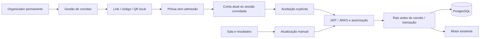

# Etapa 5D — convites e admissão de amigos

Entrega local em **25/11/2026**. Implementados convites para jogar/assistir, link/código/QR reais, sessão convidada opcional e admissão transacional sobre a API existente. A sala consulta os dados confirmados por atualização manual. O servidor continua no computador de desenvolvimento; um link de loopback não oferece acesso pela internet.

**Etapa 5D concluída e comprovada localmente:** 96 casos de navegador, 164 testes Jest, 37 PostgreSQL, 5 Node e 15 no runner Auth aprovados, além dos builds. Homologação em aparelho e operação pública continuam pendentes; bundles Hermes não as substituem.

## Auditoria e preservação

A execução começou em `main`, limpa e sincronizada com `origin/main`, em `f4cabfe`. O push solicitado depois da 5C já havia enviado os 19 commits anteriores. O estado descrito no relatório 5C é histórico; nenhum commit foi recriado. Antes das edições foram executados status, branch, log de 25 commits, diffs normal/cached e arquivos não rastreados. Não havia trabalho 5D iniciado nem instrução AGENTS adicional.

Lidos README, 5A–5C, arquitetura, decisões visuais, migrations/RLS, Auth, membros, comandos, repositório, store, sala, rotas e testes. A base já oferecia identidade/perfis, campeonatos locais/remotos, importação, resultados e journal idempotente. Ela foi reexecutada: TypeScript app/backend, ESLint, **140 Jest/23 suítes, 3 Node, 24 PostgreSQL, 7 subtestes Auth + pai e 84 Playwright**, aprovados, sem skips no navegador.

Docker estava parado e foi iniciado. A primeira preparação ocorreu antes de o engine estar pronto; a repetição recuperou a stack. Para habilitar Anonymous Sign-ins, foi usado `supabase stop` padrão, com backup, seguido de `auth:local`, preservando os dados e aplicando a migration 006. Não houve reset, exclusão de volumes, `--no-backup`, alteração de firewall, projeto remoto, push ou deploy. `.env.local` e chave de assinatura foram preservados.

Motor, store, envelope `matchmaking-local-v1`/versão 1, perfil local, IDs legados, tema, fontes e logo permanecem preservados. Convite, login, logout ou troca de conta não importam/apagam torneios nem associam jogadores por nome. Os E2E comparam o envelope local byte a byte.

## Arquitetura e papéis



| Papel | Leitura | Escrita |
| --- | --- | --- |
| Organizador permanente | Torneio próprio, convites e membros | Gestão, preparação, sorteio e resultados |
| Participante | Torneio explicitamente admitido | Nenhuma edição competitiva |
| Espectador | Torneio explicitamente admitido | Nenhuma; não ocupa vaga |
| Convidado autenticado | Acesso mínimo do papel admitido | Aceitação própria; sem criar/importar/administrar ou editar perfil remoto |
| Sem sessão / externo | Prévia mínima com credencial válida | Nenhuma |

Ownership, membership e jogador competitivo são entidades distintas. `participant_id` vincula explicitamente um membership ao jogador do mesmo torneio. Apelido e `profileId` importado não concedem autoridade. Nomes iguais criam jogadores diferentes; não há reivindicação de vaga existente, transferência de propriedade ou vinculação definitiva de contas.

Detalhes acrescentam `access.role` e, quando houver, `access.participantId`. Participante/espectador não recebem formulário de placar, correção, sorteio ou gestão. A API aplica as negativas independentemente da interface. A lista remota inclui torneios próprios **ou admitidos**; a lista administrativa de membros é exclusiva do organizador.

## Migration e acesso ao banco

Criada **`20261125000600_secure_invites.sql`**, incremental sobre as cinco anteriores:

| Recurso | Conteúdo |
| --- | --- |
| `public.tournament_members.participant_id` | FK composta para jogador do mesmo torneio, binding único, espectador sem vínculo competitivo |
| `matchmaking_private.tournament_invites` | UUID, torneio/criador/papel, digests únicos, criação/expiração, máximo/usos e revogação |
| `matchmaking_private.invite_receipts` | Ator/comando únicos, hash protegido, torneio e resposta histórica sem credencial |
| `matchmaking_private.invite_events` | Auditoria imutável de criação, revogação, aceitação e remoção de acesso |
| `matchmaking_private.invite_rate_limits` | Bucket HMAC, tentativas e reinício da janela pelo relógio do banco |

As **15 tabelas** de domínio/apoio têm RLS. As quatro novas são privadas, fora da Data API e sem grants para `PUBLIC`, `anon`, `authenticated` ou `service_role`. O serviço só recebe o necessário para inserir/ler convites, atualizar usos/revogação, registrar eventos/recibos e gerir memberships. Eventos/recibos não recebem UPDATE/DELETE; ownership continua sem alteração pelo serviço.

O login permanece NOINHERIT/NOSUPERUSER/NOBYPASSRLS e usa `SET LOCAL ROLE matchmaking_command`. Como essa role trata vários torneios, autorização por recurso no serviço continua obrigatória. A conexão PostgreSQL é exclusiva do servidor.

Uma política restritiva impede UPDATE de nickname com `is_anonymous=true`. O perfil neutro da 5B continua atendendo às FKs/leitura própria. As políticas anteriores de leitura própria/admitida e ausência de escrita competitiva direta foram preservadas. A função privilegiada `require_recoverable_owner`, com nomes qualificados e `search_path=''`, consulta `auth.users` e rejeita proprietário anônimo; não concede leitura de Auth ao serviço nem execução aos clientes. O serviço também recusa criação/importação/gestão por convidado.

## Contratos HTTP

JSON, `Cache-Control: no-store`, `Referrer-Policy: no-referrer` e corpo de escrita até 16 KiB. Contratos rejeitam versão/campos extras e obtêm ator exclusivamente do JWT. Gestão exige proprietário permanente; aceitação exige sessão permanente ou anônima autenticada. Prévia pode ser pública.

| Endpoint | Contrato |
| --- | --- |
| `POST /invites` | `commandId`, `commandVersion:1`, `tournamentId`, `type:create_invite`, `payload:{role,expiresInHours,maxUses}` |
| `POST /invites/revoke` | Mesmo envelope, `type:revoke_invite`, `payload:{inviteId}` |
| `GET /tournaments/:uuid/invites` | Metadados sem segredos; ativos primeiro, até 100 entradas |
| `GET /tournaments/:uuid/members` | Memberships/binding; até 200 acessos totais no MVP |
| `POST /members/remove` | Envelope de gestão, `type:remove_member`, `payload:{userId}` |
| `GET /invite-preview` | Token no header `X-Invite-Token`; não aceita segredo em query |
| `POST /invite-preview` | `{kind:"code",value:"…"}` ou credencial de token; sem admissão |
| `POST /invite-acceptances` | `{commandId,commandVersion:1,credential:{kind,value},displayName?}` |

Criação fresca retorna metadados, `shareUrl`, `code` e `development`. Replay retorna metadados/`replayed:true`, **sem segredo**. Aceitação retorna UUID do torneio, papel efetivo, ID competitivo quando houver, revisão e `alreadyMember`. O cliente lê depois o snapshot autorizado; se essa leitura falhar, informa atualização pendente sem negar um commit confirmado.

Erros: 400 contrato; 401 sessão; 403 autorização; 404 credencial desconhecida; 409 capacidade/torneio iniciado/chave reutilizada/limite de membros; 410 expiração/revogação/uso esgotado; 429 `INVITE_RATE_LIMITED` com `Retry-After:60`; 503 sem segredo configurado. A interface traduz os códigos sem SQL/DSN. Não existe enumeração pública por UUID; token/código desconhecidos recebem erro genérico.

## Tokens, códigos e abuso

Token: **32 bytes aleatórios criptográficos (256 bits)**, 43 caracteres base64url, somente SHA-256 com prefixo de propósito no banco. Código: oito caracteres de alfabeto de 32 símbolos, sem 0/1/I/O, **40 bits**, gerados por `randomBytes` sem viés; normaliza maiúsculas e remove espaços/hífens. Código usa HMAC-SHA-256 com segredo exclusivo do servidor e propósito separado, evitando SHA-256 puro de um espaço curto.

Validade de 1–168 horas, 1–100 admissões efetivas e até 20 convites ativos por torneio. Status deriva de revogação, expiração pelo relógio PostgreSQL e usos. Até 200 memberships são admitidos sob lock da raiz; a listagem não esconde acessos posteriores a um limite silencioso. Isso é separado das 4/8/16 vagas competitivas.

Prévia/aceitação compartilham limite de **60 tentativas/IP em janela de 60 segundos**; a aceitação tem também **20 tentativas/ator** na mesma janela, persistidas no banco. O IP vem do socket, normalizado; `X-Forwarded-For` não é confiado. Buckets não guardam IP/UUID em claro. O contador confirma em transação separada: falha/rollback da admissão não devolve orçamento. Reiniciar com o mesmo segredo preserva o limite. Limpeza de buckets antigos é limitada por operação. Não é proteção completa contra DDoS ou criação massiva de identidades.

`api:local` gera uma vez `backend/.invite-pepper`, ignorado e preservado nos reinícios. O valor só chega ao processo servidor, nunca a `EXPO_PUBLIC_*`. Ele também protege hashes de recibos/buckets. Não o apague/rotacione sem política de migração: códigos existentes e replays pendentes dependem dele. Backup/rotação/versionamento desse segredo continuam pendentes antes da operação pública.

## Prévia, aceite e gestão

Abrir link, consultar código, renderizar QR ou iniciar sessão convidada **não ocupa vaga nem consome uso**. Prévia mostra nome, modalidade, formato, status, papel, disponibilidade e validade; não retorna jogadores/placares/histórico privados. Identidade já admitida pode receber seu próprio membership para abrir o torneio mesmo após revogação/esgotamento; isso não admite outra pessoa.

Somente **Entrar na competição** ou **Acompanhar campeonato** efetiva a entrada. Jogador novo exige apelido, preparação e vaga. Espectador entra também após sorteio sem alterar revisão competitiva, chave, resultados ou campeão. Membro existente mantém seu papel, sem duplicação, uso adicional ou promoção implícita por outro convite.

Link/código aparecem apenas na criação fresca e ficam em memória. A lista não os recupera de hashes. Após resposta perdida na criação, replay confirma a operação sem reconstruir o segredo; o organizador pode conferir/revogar aquele convite e criar outro explicitamente. Revogação ou atualização confirmada limpa o QR/link que deixou de estar ativo.

Revogar impede novas admissões e preserva membros. Remover acesso é outra operação confirmada/auditada. Membership ligado a jogador não é removido diretamente: na preparação, o organizador primeiro remove o jogador, preservando sua reserva de ID e convertendo o membership em espectador; depois pode remover o acesso. Após início não há remoção de jogador/chave. Remover acesso não revoga convite ainda válido: outra aceitação explícita nova pode readmitir se as regras permitirem; replay do recibo antigo não readmite.

## Transação, concorrência e idempotência

1. Valida JWT/claims e contrato antes da conexão de domínio; aplica orçamento de tentativa.
2. Abre transação no client de `pool.connect()`, assume role local e timeouts 3/5 s da 5A.
3. Serializa ator/comando com advisory lock transacional, localiza digest e bloqueia **raiz do torneio antes do convite**. Gestão, sorteio, resultados e remoções respeitam a mesma raiz.
4. Revalida acesso para recibos; hash igual retorna aplicação anterior antes de conferir validade/usos. Payload diferente com mesma chave conflita.
5. Para entrada nova, verifica membership, relógio após espera de locks, revogação, usos, limite de membros e, para jogador, preparação/capacidade.
6. Reutiliza o motor para acrescentar somente o novo jogador em draft, atribui `p-<UUID>` e reserva permanentemente esse ID.
7. Persiste agregado/revisão/evento competitivo quando houver jogador novo, membership, uso, evento de convite e recibo na **mesma transação**.
8. Responde depois do COMMIT. Falha reverte todas essas mudanças; rollback malsucedido descarta a conexão.

Consultas no mesmo client, aguardadas em sequência, sem chamada externa com lock aberto, seguindo [node-postgres](https://node-postgres.com/features/transactions). Não existe escrita otimista, motor SQL paralelo ou INSERT isolado de membership.

Dois usuários disputando última vaga/uso não ultrapassam o limite: um confirma e outro recebe indisponibilidade. Convites diferentes também disputam a raiz. Torneios independentes não dependem de lock global. Testes observam espera real no PostgreSQL antes de avançar a expiração, além de rollback depois de gravar o agregado.

Replay do mesmo ator/comando/payload após resposta perdida devolve a aplicação confirmada, inclusive após revisão avançada ou convite revogado, enquanto o acesso atual permanece autorizado. Não incrementa usos/revisão nem cria jogador. Membro removido recebe 403 nesse replay. Recibo histórico não substitui snapshot atual. A garantia é aplicação única por chave, sem promessa de entrega de rede exatamente uma vez.

## Sessão convidada e journal

`enable_anonymous_sign_ins=true` está ativo no Auth local real. O usuário inicia voluntariamente **Continuar como convidado** e depois confirma o ingresso. Sessão registrada existente é preservada, incluindo quando precisa de revalidação; o controller confere também a sessão conhecida pelo SDK antes de iniciar uma anônima. Respostas tardias/remontagens respeitam a serialização/invalidação da 5B.

Anonymous Sign-ins cria usuário Auth com JWT **`authenticated` e `is_anonymous=true`**; não é a role PostgreSQL `anon`. A claim é validada como booleana. Persistência/refresh usam o SDK e os adaptadores da 5B: localStorage web e SecureStore fragmentado nativo. Convidado não cria/importa/administra torneios, altera resultados ou edita perfil remoto; apelido de ingresso pertence ao jogador.

Sair, apagar dados, desinstalar ou mudar de instalação pode perder essa identidade sem recuperação por e-mail. Outro convidado não a recupera pelo apelido. Não há conversão, transferência ou vinculação automática a conta permanente. [Supabase Anonymous Sign-ins](https://supabase.com/docs/guides/auth/auth-anonymous) documenta essas fronteiras e proteção contra abuso. CAPTCHA/provedor público e limpeza de identidades anônimas não foram configurados. O limite Auth local foi ajustado para 200 criações/h para as suítes; não é parâmetro homologado de produção.

Cache remoto em memória é isolado por API/identidade e limpo na saída/troca. Continuação do convite durante login voluntário fica somente em memória. **Exceção para resposta perdida:** antes do POST de aceitação, o journal separado guarda o envelope exato, incluindo token/código, no escopo API/usuário. LocalStorage/AsyncStorage não é cofre criptografado. O segredo é removido após confirmação ou rejeição definitiva; falha de armazenamento depois do commit conserva pendência para replay seguro. Logout preserva a tentativa da mesma identidade, sem leitura/envio pela conta seguinte. Identidade anônima perdida não pode retomá-la por outro usuário.

Sem escrita durável não há POST. Offline não anuncia sucesso/reserva vaga nem reenfileira automaticamente. Retomar usa o mesmo ID/payload. Se só a releitura falhar após commit, a interface informa entrada confirmada/atualização pendente. Retenção, eliminação voluntária, ameaças/criptografia do journal e política de recibos precisam de revisão antes do uso público.

## QR, plataformas e interface

QR local por **`qrcode-generator 2.0.4`**, renderizado com **`react-native-svg 15.16.0`**, correção M e margem livre de quatro módulos. Preto/branco, loading/erro, ampliação e alternativa textual. Contém exatamente o link; não cria credencial nova nem usa serviço externo. Compartilhar usa Web Share/Share nativo e fallback de cópia por **`expo-clipboard ~58.0.4`**. Compartilha-se o link, sem exportar imagem do QR.

Compatibilidade consultada antes da instalação: [SVG no SDK 58](https://docs.expo.dev/versions/v58.0.0/sdk/svg/), [Clipboard](https://docs.expo.dev/versions/latest/sdk/clipboard/) e [encoder JavaScript](https://github.com/kazuhikoarase/qrcode-generator). `jsqr 1.4.0` é devDependency para decodificação independente. Expo/Supabase não foram atualizados; o check do SDK aprovou o conjunto.

O link gerado é `<ORIGEM_CONFIGURADA>/invite#token=…`: fragmento não vai no HTTP inicial e é removido do histórico visível por `replaceState` ao abrir. Prévia envia segredo em header/body, sem referrer/cache. Meta de referrer e header do preview reforçam a fronteira; hospedagem futura deverá preservar headers e revisar logs/terceiros. Não há analytics de convites.

| Destino | Evidência / limite |
| --- | --- |
| Web `/invite` | Código/fragmento, convidado/login/aceite testados em Chromium |
| Web `/invite/[token]` | Compatibilidade com captura/higienização; geração prefere fragmento |
| `matchmaking://invite/<token>` ou fragmento | Parser/rotas preparados e testados em contrato; build instalado pendente |
| `exp://IP:8081/--/invite/<token>` ou fragmento | Parser de desenvolvimento testado; recebimento real Expo Go pendente |
| App Links / Universal Links | Pendentes de domínio HTTPS, associação e build; nenhum domínio inventado |

Novo fragmento na mesma página, troca de token ou identidade limpam a prévia anterior. Listeners são removidos ao sair. Query, credenciais na URL, parâmetros duplicados, token inválido e path+fragmento ambíguo são recusados. Expo Router/scheme existentes foram reutilizados. As [limitações do Expo Go](https://docs.expo.dev/linking/overview/) exigem prova em development build para homologar abertura fria/quente.

Referência principal: [decisões existentes](design-decisions.md), branco/grafite `#191919`/laranja `#FF6A00`, Barlow Condensed ExtraBold, Inter e logo original. Skill Refero consultada; pesquisa ao vivo retornou `NO_SUBSCRIPTION`. Foram usados o design/referências já pesquisados e o guia de craft da skill, sem redesign.

Métodos agrupados na sala; papel explícito antes de criar; prévia separada do aceite; formulários curtos com rótulos, paste/teclado e feedback de cópia; QR centralizado/ampliável. Capturas vazias de entrada em 320/1440 px foram inspecionadas sem overflow e sem dados de conta/credenciais, em `.artifacts/` ignorado. Leitor de tela, fonte ampliada, teclado Samsung e câmera/aparelhos continuam pendentes.

## Sala e preparação para 5E

**Atualizar acessos** busca detalhe, convites e membros; **Atualizar campeonato** atende o membro sem gestão. Há loading/erro e preservação dos dados confirmados se uma atualização falhar. Jogadores vinculados, espectadores, vagas e convites aparecem separados. Outra sessão só vê a admissão depois de atualizar. Não há polling, Realtime, WebSocket ou simulação de sincronização contínua.

Revisões competitivas, leitura consistente, memberships explícitos, eventos e cache por identidade preparam a 5E. Ela deverá publicar sinais pós-commit e reler estado autorizado, tratando remoção, lacunas, reconexão/background. Mudança só de acesso não incrementa revisão competitiva; a 5E deverá observar também memberships/eventos de convite.

## Validação executada

| Verificação | Resultado final |
| --- | --- |
| TypeScript app/backend / ESLint | Aprovados, strict |
| Jest/RNTL | **164 testes / 25 suítes**, incluindo os 140 anteriores |
| Node | **5 testes**: 3 anteriores ampliados + 2 de configuração CORS |
| PostgreSQL real | **37 testes**, migrations/asserts aprovados; 24 anteriores + 13 de convites |
| Supabase Auth real | **15 no runner**: 7 anteriores + pai; 6 novos + pai |
| Playwright | **96 aprovados em 15,5 min**, sem falhas/skips: 84 anteriores + 12 convites |
| Export web / build backend | Aprovados; web final reexportada com API estável em `127.0.0.1:8090` |
| Expo dependency check | `Dependencies are up to date` |
| Android / iOS | Dois bundles Hermes exportados; sem APK/IPA ou aparelho |
| npm audit | **22 moderados, zero altos/críticos**, sem correção forçada |

PostgreSQL cobre exibição única de credenciais, gestão restrita, prévia sem consumo, ativos além de 100 históricos, limite de 200 acessos, vínculo explícito/nome repetido, replay após revisão/revogação, última vaga entre convites diferentes, último uso, identidade concorrente, torneios independentes, espectador após início, expiração após lock, rollback após gravar jogador, rate limit independente do rollback, RLS e replay negado após remoção. As provas anteriores de resultados, importação e concorrência permanecem.

Auth prova **usuário anônimo real → JWT ES256/JWKS → HTTP compilado → login PostgreSQL restrito → membership/recibo**, ao lado de contas permanentes distintas. Valida restauração/refresh SDK, PostgREST/RLS, perfil protegido, ausência de ownership, revogação sem expulsão e remoção sem replay. A restauração dessa suíte usa Map compartilhado do SDK; reload real é coberto no navegador. Brute force esgota 60/IP, recebe 429, reinicia servidor e continua limitado variando `X-Forwarded-For`. O limite por ator é testado na integração SQL.

Os 24 novos Jest cobrem convidado/sessão existente, journal antes do POST, replay, falhas antes/depois de commit, remoção da credencial confirmada, isolamento A/B/resposta tardia, criação sem recuperar segredo, QR/código/URLs nativas, troca de rota/revalidação e QR revogado.

Os 12 E2E novos são três jornadas por largura (1440/768/375/320): gestão/cópia/QR decodificado por jsQR, convidado/conta, nome igual, atualização manual e somente leitura após início; erros/lotação/rede; commit com resposta perdida, reload/replay, A/B e envelope local intacto. Expiração E2E ajusta administrativamente só o convite da fixture; não aguarda horas. `route.fetch` apenas interrompe resposta após commit real; `route.abort` simula rede indisponível. Não há mocks de Auth/banco/locks/transações.

Traces/screenshots/vídeo desses fluxos ficam desligados. QR/clipboard são conferidos em memória e clipboard é limpo. Uma falha inicial gerou `error-context.md` automático, ignorado, sem segredo observado; isso não garante ausência universal de dados sensíveis em artefatos.

A inspeção final confirmou **seis migrations, zero bancos/logins temporários, zero contas de teste ou anônimas e zero e-mails temporários remanescentes**. Configuração pública ignorada confere com a stack local. Foram examinados **255 arquivos** revisáveis e artefatos web/Hermes contra os segredos conhecidos da stack, parte privada da chave de assinatura e pepper: zero ocorrências, sem imprimir os valores. Essa busca específica não é auditoria completa de segurança. O bucket IP compartilhado permanece persistido conforme a política de rate limiting.

Falhas corrigidas: URL HTTP malformada podia lançar antes do tratamento e encerrar o servidor; agora recebe 400, provado por socket seguido de requisição válida. Papel JSON com coerção excepcional é recusado como contrato. Ativos não ficam escondidos pelo histórico e membros têm teto explícito. QR revogado é limpo após replay/atualização. O E2E revelou outro fragmento na mesma página ignorado; a correção passou sem relaxar expectativas. CORS aceita origem LAN privada exata somente em desenvolvimento, com negativas de host/porta vizinhos e HTTP público. Nenhum teste foi removido; expectativas antigas “Em breve” agora verificam o fluxo real.

A matriz completa usou o frontend final. O último ajuste de configuração CORS, feito enquanto ela executava, foi validado separadamente por TypeScript/lint, 5 Node, 37 PostgreSQL com HTTP compilado e 15 Auth real, sem mudança no frontend. A consulta inicial à rede e os runners que exigem subprocessos/Docker precisaram de execução fora da sandbox; bloqueios de ambiente não foram contabilizados como aprovações.

## Executar localmente

Node 24, Docker Desktop ativo e portas livres:

```powershell
npm.cmd ci
docker desktop start
npm.cmd run auth:local
$env:MATCHMAKING_INVITE_BASE_URL = 'http://127.0.0.1:8081'
npm.cmd run api:local
```

Em outro terminal:

```powershell
$env:EXPO_PUBLIC_MATCHMAKING_API_URL = 'http://127.0.0.1:8090'
npm.cmd run web
```

`auth:local` preserva configuração pública existente; `api:local` usa login PostgreSQL temporário restrito e preserva o pepper ignorado. Interrupção forçada pode impedir limpeza; inspecione o identificador antes de remover algo. Não copie DSN, senha, service role, chave privada ou pepper para app/Git/links/logs/`EXPO_PUBLIC_*`. Sem pepper, os endpoints novos retornam indisponibilidade explícita. Servidor persistente manual segue a role da [5A](stage-5a.md#executar-localmente) e `backend/.env.example`.

Entre com conta confirmada pelo [Mailpit local](http://127.0.0.1:54324), abra torneio na conta/sala e crie convite. Abra-o em outro contexto de navegador ou use **Entrar com código**. Escolha convidado ou conta, confirme e atualize no organizador. Loopback funciona somente no computador.

```powershell
npm.cmd run typecheck
npm.cmd run backend:typecheck
npm.cmd run lint
npm.cmd test -- --silent
npm.cmd run backend:test
npm.cmd run backend:test:db:local
npm.cmd run backend:test:auth
npm.cmd run check:deps
$env:PLAYWRIGHT_CHROMIUM_EXECUTABLE_PATH = 'C:\Program Files (x86)\Microsoft\Edge\Application\msedge.exe'
npm.cmd run test:auth:e2e
npx.cmd expo export --platform android --platform ios --output-dir .artifacts/stage5d-native
```

E2E inicia API efêmera e fornece só configuração pública ao export; credenciais administrativas ficam no processo de teste. Não exporte sobre `dist` durante a suíte. `test:e2e` sem variáveis de integração deixa casos reais como skipped; `test:auth:e2e` os executa. Runners removem somente contas/e-mails/torneios/logins/buckets exatos daquela execução. O bucket IP compartilhado do E2E não é zerado por caso. PostgreSQL usa banco descartável próprio.

## Galaxy S25 Ultra e dois dispositivos — roteiro pendente

Não houve execução em aparelho ou development build instalado disponível. ADB não foi encontrado no PATH nem no caminho padrão do SDK Android deste Windows. Estes passos não são resultados no S25/iOS. LAN não é publicação pela internet.

1. PC/S25 na mesma LAN privada, sem isolamento de clientes; descubra IPv4 ativo por `Get-NetIPConfiguration`. Loopback no telefone aponta ao telefone.
2. Prepare Auth/callback conforme a [5B](stage-5b.md#galaxy-s25-ultra--preparação-e-roteiro-pendente), preservando chave/volumes/issuer JWT. Não exponha Mailpit/PostgreSQL. Endereço navegável de e-mail e issuer são opções distintas.
3. API: defina `MATCHMAKING_DEV_HOST=<IP_PC>`, `MATCHMAKING_INVITE_BASE_URL=http://<IP_PC>:8081` e `CORS_ORIGINS=http://127.0.0.1:8081,http://localhost:8081,http://<IP_PC>:8081`. Execute `api:local`. HTTP privado exige desenvolvimento e origem exata; não há wildcard ou bind `0.0.0.0`.
4. Expo: configure `EXPO_PUBLIC_MATCHMAKING_API_URL=http://<IP_PC>:8090` e Auth `http://<IP_PC>:54321`, só chave pública. Execute `npx.cmd expo start --go --lan --clear` e abra o app no Expo Go para testar código/admissão nativos. O navegador pode abrir a prévia em `http://<IP_PC>:8081`, mas Auth web exige WebCrypto/contexto seguro: HTTP LAN comum não fornece essa garantia. Para aceitar no navegador do telefone, prepare HTTPS confiável também para as APIs, sem mixed content; isso não foi configurado nesta entrega. Não desative a proteção do navegador.
5. Se necessário, permita só TCP 8090/54321/8081, perfil Privado e origem do S25. Não desative firewall, permita 54322/54324 ou encaminhe roteador. Nenhuma regra foi criada; reveja regras existentes porque a CLI Docker publica portas por padrão.
6. Organizador no PC gera convite de jogador com origem LAN e copia código. S25 consulta no Expo Go, inicia convidado e confirma apelido/entrada. Organizador atualiza e verifica binding/uso/vaga. O navegador PC usa loopback, que atende à exigência WebCrypto.
7. Gere outro convite e leia QR com a câmera: mesmo link LAN, prévia mínima e nenhum consumo. Em HTTP LAN, continue pelo código dentro do app; aceite inteiramente web no telefone exige a preparação HTTPS do passo 4. Cópia/compartilhamento dependem do suporte/contexto da plataforma e só alcançam quem acessa o PC. Não há HTTPS/origem pública configurada.
8. No Expo Go, HTTP normalmente abre navegador. Use código dentro do app ou prepare incoming link exato `exp://<IP_PC>:8081/--/invite/<token>` para a prova, sem expor segredo em history/prints/Git. Teste `matchmaking` em development build; não existe associação HTTPS/App Links.
9. Complete vagas/sorteie no organizador. Jogador consulta sem controles competitivos. Aceite espectador depois do início sem mudar chave/revisão/vaga. Registre resultado no PC e atualize no S25; não espere sincronização automática.
10. Teste última vaga/uso concorrente, revogação/expiração, replay após resposta perdida, offline, fechamento/abertura/background/logout e nova identidade. Novo convidado não recupera antigo; apelido não reivindica vaga; local/rascunho ficam intactos.
11. Homologue câmera, abertura fria/quente, SecureStore, teclado Samsung, safe areas, fonte ampliada, TalkBack e movimento reduzido. Repita em iOS antes de declarar homologação.
12. Pare somente API/Metro da prova, remova a regra temporária exata e reverta suas edições/variáveis LAN. Preserve volumes, chave e pepper. Não há túnel público de Auth/API/banco.

## Arquivos e commits

Banco: migration 006/asserts/bootstrap. Backend: `invites.ts`, Auth/serviços/HTTP/CORS e testes SQL/Auth. Cliente: sessão convidada, journal/cache/permissões. Interface: `InviteManager`, `InviteQr`, `InviteScreen`, helpers `features/invites`, rotas e Home/sala/partida/perfil. Tooling: pepper, config Auth, preview, bibliotecas e E2E. Documentação: este relatório, README, arquitetura e decisões visuais.

| Commit | Bloco |
| --- | --- |
| `673f269` | A: migration, RLS/grants, vínculo e asserts |
| `823f7fb` | B: convites, admissão atômica, Auth e concorrência |
| `85a9610` | C: convidado e journal de retomada exata |
| `a349444` | C: interface, QR/cópia/compartilhamento, papéis e rotas |
| `7990014` | D: CORS LAN explícito somente em desenvolvimento e testes |
| `1ae1d0e` | D: prova E2E real de QR/admissão/retomada nas quatro larguras |
| Commit deste relatório | D: documentação final; hash em `git log` e na resposta final |

Stage seletivo e autor histórico por comando, sem alterar configuração Git. Sem reset/clean/amend/push/force push/deploy. Segredos reais/builds/capturas/traces ignorados. Estado ao encerrar: `main` limpa, **sete commits locais à frente de `origin/main`**, todos desta etapa. Hash da documentação registrado na resposta final e em `git log`.

## Critérios e limites

Critérios comprovados no ambiente local pelas suítes descritas acima:

- [x] Organizador cria convite online.
- [x] Convidado abre link válido.
- [x] Convidado utiliza código.
- [x] QR contém o mesmo link real.
- [x] Convidado entra sem cadastro convencional.
- [x] Usuário autenticado aceita com sua identidade atual.
- [x] Participantes ocupam vagas corretamente.
- [x] Espectadores não consomem vagas.
- [x] Torneio cheio não admite jogador adicional.
- [x] Torneio iniciado não recebe jogador novo.
- [x] Abertura/prévia não consome convite.
- [x] Expiração é recusada.
- [x] Revogação é recusada.
- [x] Limite de usos funciona.
- [x] Repetição não duplica membros.
- [x] Concorrência não ultrapassa vagas/usos.
- [x] RLS/permissões permanecem restritas.
- [x] Organizador consulta membros.
- [x] Atualização manual funciona.
- [x] Torneios locais permanecem intactos.
- [x] Regressões 5A–5C aprovadas.
- [x] Testes relevantes passaram.
- [x] Commits organizados.
- [x] Documentação atualizada.

Pendências antes de uso externo: aparelhos/deep links reais, Safari/Firefox/acessibilidade; HTTPS/domínio/associações; CAPTCHA/abuso de Auth, proxy confiável/rate limiting distribuído/carga; política de identidades anônimas/dados/journal/recibos; retenção/rotação do pepper; revogação imediata de access JWT; backup/restauração/época; TLS/pooler/empacotamento independente; observabilidade/revisão dos 22 alertas moderados. Sem envio externo de e-mail ou scanner físico.

A limitação da 5B permanece: logout não invalida imediatamente um access JWT emitido. Remover membership corta novas leituras autorizadas, mas não apaga snapshots já recebidos. Não há disponibilidade ou backup remoto.

A **5E** deverá implementar sincronização autorizada/reconexão com sinais após commit e invalidação de acesso/cache. Realtime, WebSockets, chat, notificações, rankings globais, pagamentos e deploy seguem fora desta entrega.
