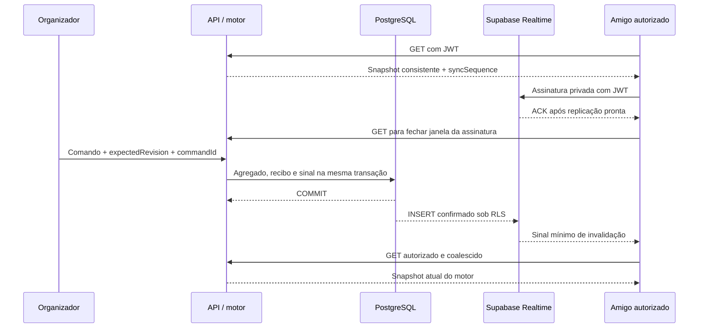

# Etapa 5E — sincronização autorizada e reconexão

Execução local iniciada em **26/11/2026**. Supabase Realtime informa alterações confirmadas; PostgreSQL, API e motor continuam decidindo o estado. Modo local, envelope v1, logo e identidade visual preservados. Sem serviço público, push ou deploy.

**Registro em validação final:** nesta retomada, 199 Jest/30 suítes, TypeScript app/backend, ESLint, 5 Node, 48 PostgreSQL, 15 Auth e 9 Realtime passaram. A primeira matriz de 112 casos de navegador está em execução; haverá nova rodada com a correção final de renovação abaixo. Homologação nativa permanece pendente.

### Auditoria da retomada

Retomada em **26/11/2026**, em `ba65900`, com dois commits 5E (`bd0fc13` e `ba65900`) à frente de `origin/main`, alterações não commitadas de cliente/interface/testes e este relatório já existente. Status, branch, log de 30 commits, diffs completos e arquivos não rastreados foram examinados. Portanto, o pedido anterior executou trabalho substancial. Tudo foi preservado; não houve reinício da implementação.

| Recurso encontrado | Classificação na retomada |
| --- | --- |
| Migration 007, sinais transacionais, cursor/API | Implementados/commitados; revalidação real pendente nesta retomada |
| Configuração Supabase e suíte WebSocket | Implementadas/commitadas; Docker encontrado parado |
| Coordenador, transporte, cache/provider | Implementados, não commitados; revisão e testes finais pendentes |
| Status, sala, edição concorrente e campeão | Implementados, não commitados; homologação final pendente |
| Testes e relatório | Parciais: TypeScript acusou tipagem do mock fetch e Jest encontrou seletor ambíguo no novo teste de retorno da lista |

Primeira checagem desta retomada: 5 Node aprovados, 193 Jest aprovados e um caso novo falhou; não se contabilizou aprovação geral. Docker Desktop foi iniciado sem reset/remoção de volumes. As provas anteriores abaixo são registros da execução inicial e serão distinguidas das repetições finais.

Correções da retomada: mock HTTP recebeu tipo de resposta explícito, e o teste passou a consultar o status dentro do card acessível do torneio, evitando confusão com o filtro. As verificações de retorno ao foco, resumo atualizado, ausência de assinatura própria e modo local foram preservadas. Depois disso, todas as 30 suítes passaram. A pesquisa Refero desta retomada também retornou `NO_SUBSCRIPTION`; o sistema visual/referências existentes continuam como alvo.

## Execução inicial preservada

A execução inicial já registrada começou em `main` limpa e sincronizada com `origin/main`, HEAD `75414c1`. Os sete commits da 5D já estavam enviados; seu relatório registra o estado histórico. Nenhum commit foi recriado. Status, branch, log de 25 commits, diffs normal/cached e arquivos não rastreados foram verificados antes daquelas edições. Nenhum AGENTS adicional foi encontrado. O estado diferente encontrado nesta retomada está discriminado acima.

Consultados README, relatórios 5A–5D, arquitetura, decisões visuais, configuração Supabase, migrations/grants/RLS, serviços, Auth, cache/journal, telas e testes. Base reexecutada: TypeScript app/backend, ESLint, **164 Jest/25 suítes, 5 Node, 37 PostgreSQL e 15 no runner Auth**, aprovados. Os 96 casos existentes de navegador foram preservados para a matriz final, sem execução baseline separada nesta etapa. O primeiro Node/TSX encontrou restrição da sandbox (`uv_os_get_passwd`); a repetição autorizada passou.

Docker estava parado e foi iniciado. Realtime estava desabilitado no TOML e excluído no runner. Foi habilitado com `supabase stop` padrão, que confirmou backup, seguido de `auth:local`. Volumes, usuários, `.env.local`, chaves ES256 e pepper preservados. Sem reset, exclusão de volumes, `--no-backup`, firewall ou projeto remoto.

## Arquitetura escolhida

**Postgres Changes de sinais mínimos sob RLS**, com canal privado e o SDK Supabase existente. Sem servidor WebSocket próprio, Socket.IO, Presence ou Broadcast de snapshots.

| Alternativa | Avaliação para este MVP |
| --- | --- |
| Postgres Changes | SELECT autorizado por registro/assinante; sinais pequenos e releitura pela API existente. Escolhida e comprovada com JWT ES256 e sessões independentes. |
| Database Broadcast privado | Potencial para fan-out maior; ACL de canal calculada na entrada/renovação exige estratégia adicional de revogação. Não adotado sem carga medida e protocolo equivalente de invalidação. |

Fontes primárias: [Postgres Changes](https://supabase.com/docs/guides/realtime/postgres-changes), [autorização Realtime](https://supabase.com/docs/guides/realtime/authorization), [configuração CLI](https://supabase.com/docs/guides/local-development/cli/config) e [chaves assimétricas](https://supabase.com/docs/guides/self-hosting/self-hosted-auth-keys). A decisão foi confirmada na stack, sem presumir entrega garantida ou revogação instantânea.



Stack comprovada: CLI **3.3.0**, Realtime **v2.174.5**, Auth **v2.198.0**, PostgreSQL **17.12.0.002**, Supabase JS **2.119.2**. Nenhuma dependência/versão do SDK foi alterada. `auth:local` passa a iniciar Realtime; proxy HTTP/WebSocket local na **54321**.

A primeira prova encontrou ACK anterior à replicação pronta: o canal parecia inscrito, mas perdia o primeiro sinal. `postgres_changes_options: { wait: true }`, disponível na versão instalada, resolveu a janela e foi comprovado pelo teste real, sem apenas aumentar timeout.

## Migration 007, sinais e retenção

Migration incremental **`20261126000700_tournament_realtime_signals.sql`**, preservando as seis anteriores:

| Recurso | Contrato |
| --- | --- |
| `matchmaking_private.tournament_sync_heads` | Cursor monotônico por torneio, separado da revisão competitiva/retenção; RLS, somente SELECT para serviço restrito. Torneios anteriores começam em zero. |
| `public.tournament_signals` | `tournament_id`, `sequence`, `signal_version:1`, `category`, `revision`, `recipient_user_id`, `created_at`. Sem nomes, placares, tokens, códigos, e-mails ou payloads de comando. |
| `competitive` | Evento competitivo existente, com revisão confirmada: criação/importação, participantes, sorteio, placares/correções. |
| `access` | Membership criado/alterado/removido e gestão/uso de convite, sem inventar revisão competitiva. |
| `access_revoked` | Destinatário removido e metadados mínimos; sem revisão competitiva/snapshot. |

Triggers inserem sinais **na mesma transação** do agregado/acesso. Realtime só entrega INSERT após COMMIT. Rollback remove sinal e avanço de cursor; replay idempotente não repete evento competitivo. Raiz do torneio continua sendo o lock comum; sequências são ordenadas por torneio e torneios distintos não dependem de lock global. Sem chamada externa com lock aberto.

Novos escritores e intervenções administrativas devem bloquear a raiz antes de alterar filhos. Os triggers não substituem essa ordem de locks do serviço.

No máximo **256 sinais por torneio**, com head preservado. PK `(tournament_id, sequence)` atende filtro/retenção; índice parcial `(recipient_user_id, tournament_id)` atende notificações dirigidas. Números limitados ao inteiro seguro JavaScript. O feed não é histórico recuperável. Há limite por torneio, mas não política de exclusão por tempo de torneios inativos.

Publicação `supabase_realtime` dedicada somente a `tournament_signals`, **exclusivamente INSERT**. DELETE de poda não deve ser observado nem por assinatura maliciosa de `*`/DELETE, pois o protocolo não aplica a mesma proteção RLS aos deletes. A migration recusa publicação `ALL TABLES`, schemas/tabelas alheias, sem alterá-los silenciosamente. Acrescentar outra tabela exige revisão explícita.

## Autorização e revogação

- `authenticated` tem apenas SELECT. Sinal comum exige organizador/membership atual por `can_read_tournament`; dirigido exige `recipient_user_id = auth.uid()`. `anon` não lê sinais.
- Clientes e `matchmaking_command` não inserem, alteram, apagam ou chamam o emissor. Funções privilegiadas têm `search_path=''`, nomes qualificados e EXECUTE revogado; uso apenas por triggers. Serviço permanece NOINHERIT/NOSUPERUSER/NOBYPASSRLS.
- Canal privado `tournament:<UUID>` exige leitura autorizada na política de `realtime.messages`. Ownership, RLS e grants gerenciados desse schema não foram alterados. A política existe na stack real; o banco descartável de domínio não simula Realtime.
- Autorização do canal não substitui RLS por sinal. Após remoção, socket já aberto recebe sua invalidação, sem novos sinais competitivos. Outras pessoas não veem esse aviso dirigido. Assinatura pública adversarial não contorna SELECT/RLS.
- O aviso encerra assinatura e elimina detalhe/lista daquele torneio, publicando **Acesso encerrado**. HTTP e término de journal anteriores não restauram snapshot. GET posterior recebe 403.
- Se o aviso se perder, retomada/reconexão faz GET e aplica a negativa. Offline pode manter o último snapshot até revalidação; cópias já entregues não podem ser apagadas remotamente. Sem promessa de expulsão instantânea sem transporte.

Logout continua sem invalidar imediatamente um access JWT já emitido, limite da 5B. O cliente retira canais/cache; expiração e RLS continuam no servidor. Sessão anônima autenticada recebe isolamento por `user_id`; não é `anon` e não ganha escrita competitiva.

A política de canal é calculada na entrada/renovação, conforme a documentação citada; não se pressupõe que um DELETE de membership encerre sozinho todo socket existente. A prova deixa o assinante removido conectado, observa sua invalidação dirigida e confirma ausência do sinal competitivo posterior, recebido pelo organizador. Depois encerra o canal e comprova recusa de um novo join. O aplicativo efetua o encerramento ao receber o aviso; GET/RLS sustentam a negativa mesmo para um cliente que ignore esse protocolo.

## Cliente, cache e reconexão

`TournamentRealtime` coordena leases por torneio em foco. Componentes compartilham assinatura; saída, logout, conta/API diferente, rede indisponível ou background encerram listeners/timers/canal. SDK Auth/socket compartilhado, sem cliente Supabase por partida. Criação/remoção por SDK+tópico é serializada para não reutilizar canal ainda em teardown.

**GET autorizado → assinatura privada → ACK com replicação pronta → novo GET → Conectado.** Nova leitura após rejoin, renovação de token e retorno da aplicação. Antes de retomar do background/offline, provider solicita revalidação da sessão. A/B invalida cliente anterior; callbacks/respostas tardias não publicam no seguinte.

Agrupamento de sinais em **80 ms**. Repetidos/antigos/outros torneios são ignorados; mudança durante GET pede outra consulta. GET deduplicado anterior ao sinal não consome invalidação: cursor do snapshot deve alcançar maior sequência observada antes de Conectado. Backoff de 1–30 s. Sem polling contínuo; atualização manual preservada.

Detalhe lê `syncSequence` e agregado na mesma transação consistente. Cache não regride revisão/cursor, e falha antiga não substitui estado atual. Recibos históricos continuam sem cursor obrigatório e não substituem leitura atual. Acesso não depende de revisão competitiva. Saltos são normais: sinais dirigidos a terceiros são invisíveis; lacuna pede reconciliação, sem exigir todos os números.

Cercas de geração abrangem GET, operação confirmada, término do journal e fallback de atualização. Journal/envelope da 5C/5D não mudou. Sem replay automático de escrita, confirmação otimista ou escrita da sync no `matchmaking-local-v1`.

A revisão desta retomada reproduziu uma falha adicional: 401 anterior deixava a assinatura encerrada mesmo após renovar a mesma identidade. Agora renovação/foreground refazem GET autorizado antes de reinscrever; membro ainda removido continua bloqueado, sem canal. Se um GET iniciado com JWT antigo só receber 401 depois de o token mudar, ele pode repetir **uma única leitura** com o token atual. Negativa persistente encerra o acesso; POST nunca é reaplicado por esse mecanismo. Cinco testes de regressão cobrem a recuperação, a corrida, o limite da repetição e ausência de reenvio de escrita. Quatro falharam antes das correções; os cinco e toda a suíte passaram depois (**199/30**).

## Fluxos e interface

| Área | Comportamento |
| --- | --- |
| Sala | Participantes, vagas, espectadores e convites refletem commits externos. Listas administrativas são relidas após cursor reconciliado, sem ciclo de GET do detalhe. |
| Sorteio/chave/resultados | Amigos recebem ordem persistida, avanços e placares; não executam outro sorteio. |
| Placar aberto | Guarda revisão inicial. Mudança remota preserva texto e bloqueia salvar até **Revisar resultado atualizado**. Corrida ainda não observada recebe 409 pelo `expectedRevision` antigo. |
| Campeão | Final/correção chegam automaticamente. Revalidação da mesma identidade não repete confetes; final diferente tem outra chave de apresentação. Correção anterior que invalida a final retira campeão. |
| Acesso encerrado | Retira conteúdo privado da tela/cache. |
| Local | Mesmo motor/store offline, sem assinatura. Login/sync/A→B não alteram envelope. |

Estados: **Conectando**, **Conectado**, **Reconectando**, **Sem conexão**, **Atualizando**, **Acesso encerrado**. Conectado exige ACK/reconciliação, sem selo permanente de disponibilidade. Offline/reconectando avisam que o último estado pode estar desatualizado. Atualização manual preservada.

Skill Refero consultada; pesquisa ao vivo retornou `NO_SUBSCRIPTION`. Usadas referências já pesquisadas nas [decisões visuais](design-decisions.md) e guia de craft: SAP Good Energy/Strava, branco/grafite/laranja, tipografia, labels e foco existentes. Status textual com ícone/live region, sem depender só de cor. Sem redesign, logo alterada ou imagem nova.

Nesta retomada, capturas da sala em **320/1440 px**, conectada e offline, foram inspecionadas sem overflow horizontal. Usaram conta/torneio fictícios próprios, sem gerar convite, e sem senha, e-mail ou credencial nas imagens. Os recursos exatos foram removidos ao terminar; capturas ficam em `.artifacts/`, ignorado. O botão Atualizar permanece acessível e o aviso offline quebra em linhas no celular sem sobrepor o conteúdo.

## Validação executada e restante

Windows/PowerShell, Node **24.22.1**, Docker local, Chromium/Edge. Números a fechar após matriz final:

| Verificação | Resultado registrado |
| --- | --- |
| TypeScript app/backend / ESLint | Aprovados novamente nesta retomada |
| Jest/RNTL | **199 testes / 30 suítes**, aprovados nesta retomada |
| Node | **5 aprovados** nesta retomada |
| PostgreSQL real | **48 aprovados**, 37 anteriores + 11 sinais |
| Auth real | **15 aprovados** nesta retomada |
| Realtime real | **9 no runner**, 8 filhos + pai, aprovados nesta retomada, com restart real |
| Playwright | Primeira matriz: **112 aprovados em 17,4 min**; segunda matriz com correção final de renovação em execução |
| Web/backend/Hermes/compatibilidade | Builds dos runners e dois Hermes aprovados; Expo compatível; web estável final pendente |

PostgreSQL comprova payload mínimo, publicação INSERT-only, RLS/grants, COMMIT/ROLLBACK, replay/conflito sem duplicação, rollback após gravação, acesso sem revisão falsa, remoção dirigida, retenção, concorrência e emissor negado aos clientes/serviço.

Realtime usa contas permanentes/anônima reais, JWT ES256/JWKS, HTTP compilado e login restrito. Conexões independentes observam commit, rollback sem sinal, draw/resultados/final/correção/replay, externo recusado, transporte público adversarial, remoção no canal aberto, refresh JWT e unsubscribe/reconnect. Restart só do container local identificado comprova API/DB sem Realtime e nova entrega após retorno. A variável abaixo autoriza essa interrupção isolada e o teste restaura o serviço em `finally`.

E2E: contextos independentes e serviços reais. Quatro cenários em quatro larguras: completo de 4 com espectador/correções; 8 e 16 com admissão/sorteio/primeiro resultado; offline/revogação/A-B. O de 4 conclui rodadas, corrige final e invalida final por semifinal. Completude de 8/16 e regressões continuam nos testes anteriores. Envelope local comparado byte a byte. Sem mocks de Auth, banco, API ou WebSocket; somente simulação de rede.

Traces, vídeo e screenshots desligados nos testes sensíveis. Diagnósticos automáticos de falha podem criar arquivos ignorados; não se garante ausência universal de dados pessoais em artefatos. Sem medição de FPS, carga, fan-out, bateria ou memória nativa.

Após a primeira matriz: sete migrations, **17 tabelas de domínio com RLS**, publicação dedicada INSERT-only, política privada e container Realtime ativo. Zero bancos/logins temporários, contas de teste/anônimas e e-mails remanescentes; configuração pública corresponde à stack local. Busca específica contra segredos conhecidos da stack, chave privada e pepper em **269 arquivos** revisáveis e artefatos web/Hermes: zero ocorrências, sem expor valores. A inspeção será repetida após o fechamento; não é uma auditoria completa de segurança.

Falhas intermediárias: ACK anterior à replicação; teste reutilizando canal já inscrito (teardown explícito); locator contando glifo junto do texto (passou a conferir aria-label). Revisão acrescentou cercas após journal, espera de teardown e reconciliação de GET antigo, sem remover testes/relaxar acesso.

## Executar localmente

Node 24, Docker Desktop ativo, portas livres:

```powershell
npm.cmd ci
docker desktop start
npm.cmd run auth:local
$env:MATCHMAKING_INVITE_BASE_URL = 'http://127.0.0.1:8081'
npm.cmd run api:local
```

Em outro terminal:

```powershell
$env:EXPO_PUBLIC_MATCHMAKING_API_URL = 'http://127.0.0.1:8090'
npm.cmd run web
```

Stack antiga sem Realtime: encerre processos da prova, use `npx.cmd supabase stop` padrão, depois `auth:local`. Não use reset/exclusão de volume. Configuração pública/chave/pepper preservados; API usa login restrito temporário. Segredos administrativos só nos processos servidor/teste.

Use contextos independentes: organizador cria convite, amigo entra com outra conta/convidado e abre o campeonato. Aguarde **Conectado** e confira entradas/sorteio/placar sem Atualizar. Não saia/limpe dados da identidade anônima antes de concluir a prova.

```powershell
npm.cmd run typecheck
npm.cmd run backend:typecheck
npm.cmd run lint
npm.cmd test -- --silent
npm.cmd run backend:test
npm.cmd run backend:test:db:local
npm.cmd run backend:test:auth
$env:MATCHMAKING_TEST_REALTIME_RESTART = '1'
npm.cmd run backend:test:realtime
Remove-Item Env:MATCHMAKING_TEST_REALTIME_RESTART
npm.cmd run check:deps
$env:PLAYWRIGHT_CHROMIUM_EXECUTABLE_PATH = 'C:\Program Files (x86)\Microsoft\Edge\Application\msedge.exe'
npm.cmd run test:auth:e2e
npx.cmd expo export --platform android --platform ios --output-dir .artifacts/stage5e-native
```

Sem a variável, runner Realtime falha no restart em vez de declarar aprovado/skipped. Confere o nome exato antes de parar o container e verifica sua saúde após reiniciar. Execute DB/Auth/Realtime/E2E em sequência. `test:auth:e2e` inicia API efêmera, exporta só configurações públicas e inclui todos os casos reais. Não exporte sobre `dist` durante a suíte. `test:e2e` simples sem variáveis deixa integrações skipped e não substitui essa prova.

## Galaxy S25 Ultra e segundo dispositivo — pendente

O usuário informou já ter executado o app pelo Expo Go. Nesta retomada não houve execução da 5E em aparelho/emulador/development build instalado. ADB/JDK não foram encontrados no PATH, nem ADB no caminho padrão do SDK; bundles não são APK/IPA. LAN não é internet; túnel Expo não encaminha Auth/API/Realtime.

1. PC/S25 na mesma LAN privada; IPv4 por `Get-NetIPConfiguration`. Preserve volumes, chave ES256/issuer e pepper. Siga Auth/callback da [5B](stage-5b.md#galaxy-s25-ultra--preparação-e-roteiro-pendente).
2. Inicie Docker e `auth:local`. Realtime usa proxy Supabase/Auth **54321**, incluindo upgrade WebSocket; API **8090**, Expo **8081**. Telefone não acessa PostgreSQL **54322** ou Mailpit **54324**.
3. Servidor: `MATCHMAKING_DEV_HOST=<IP_PC>`, `MATCHMAKING_INVITE_BASE_URL=http://<IP_PC>:8081`, `CORS_ORIGINS=http://127.0.0.1:8081,http://localhost:8081,http://<IP_PC>:8081`; execute `api:local`. Sem wildcard/HTTP público.
4. Expo: somente URLs/chave públicas: `EXPO_PUBLIC_MATCHMAKING_API_URL=http://<IP_PC>:8090`, `EXPO_PUBLIC_SUPABASE_URL=http://<IP_PC>:54321` e chave pública correspondente. Execute `npx.cmd expo start --go --lan --clear`. Loopback no telefone aponta ao telefone.
5. Se necessário, regras temporárias exatas TCP **8081/8090/54321**, perfil Privado e origem do S25. Não desabilite firewall, publique banco/Mailpit ou encaminhe roteador. Nenhuma regra criada; revise portas publicadas pela CLI/Docker.
6. Organizador no PC loopback, amigo por código no Expo Go. HTTP LAN web não garante WebCrypto para Auth: aceite inteiramente web exige HTTPS confiável também nas APIs, sem mixed content. Não reduza proteções. QR/deep links/build seguem a [5D](stage-5d.md#galaxy-s25-ultra-e-dois-dispositivos--roteiro-pendente).
7. Aguarde **Conectado**. Amigo entra e organizador vê vaga/membership automaticamente. Sorteie 4/8/16, registre placar e confira avanço/campeão/ranking no amigo. Membro não deve editar resultados.
8. Abra placar em duas sessões do organizador; registre numa, confira bloqueio/revisão na outra. Corrija final/semifinal: ambas convergem, sem outro sorteio ou celebração na simples reconexão.
9. Desligue Wi-Fi do S25, altere no PC e religue. Confira aviso de estado antigo e convergência; repita background/foreground. Sem Realtime, use atualização manual; o túnel Expo não recupera APIs.
10. Remova espectador com tela aberta: **Acesso encerrado**, sem novos dados. Repita offline: dados antigos só são retirados após revalidação. Logout/A→B sem cache/journal alheios; local intacto.
11. Registre modelo, Android/build, rede, orientação, escala, movimento, caso/resultado/evidência. Homologue SecureStore, teclado Samsung, safe areas, TalkBack, texto ampliado, animações/compartilhamento; repita no iPhone. Não registre tokens/QR/senha/dados pessoais.
12. Encerre só processos da prova, remova regra temporária exata e reverta variáveis/edições LAN. Preserve volumes, chave e pepper. Sem túnel público de Auth/API/banco.

## Arquivos e commits

Configuração: TOML, runner Auth e package. Banco: migration 007/asserts e testes de sinais. API: detalhe/cursor e tipo de resposta. Cliente: novos `remote/realtime.ts`, `transport.ts`; cache, provider e `useTournament`. UI: novo `ConnectionStatus`, notice, gestão de convites, partida, campeão/apresentação. Testes: runner Realtime, cache/provider/coordenador/transporte/interface e `e2e/realtime.spec.ts`; convites antigos agora aguardam atualização automática preservando botão manual. Documentação: este relatório, README, arquitetura e decisões visuais.

Checkpoints recuperáveis: `bd0fc13` e `ba65900` já existiam e foram preservados; `fa2234f` registra o cliente/reconciliação/isolamento validado nesta retomada. UI foi validada nas 194 Jest, TypeScript/lint e capturas descritas acima. A matriz E2E ainda executa; seus resultados não são presumidos. Tabela completa de commits e estado final serão registrados após a validação. Stage seletivo, autor histórico por comando sem mudar configuração Git; sem reset/amend/force push, segredos ou builds no Git.

## Limites e próximos passos

Postgres Changes autoriza por assinante, com limites de throughput/fan-out; sem benchmark/dimensionamento. Retenção por torneio não garante entrega/replay: recuperação é snapshot autorizado. Restauração/época e retrocesso de cursor, HA, proxy confiável, TLS, carga, métricas/alertas e retenção global pendentes.

Também pendentes: Android/iOS, Safari/Firefox, acessibilidade humana, domínio/App Links, CAPTCHA/abuso Auth, políticas de identidade anônima/journal/recibos, backup/rotação do pepper e observabilidade. Auditoria npm repetida nesta retomada: **22 moderados, zero altos/críticos**, sem correção forçada.

Sem chat, push notifications, ranking global, pagamentos, presença, transferência de ownership, anotador delegado ou operação pública. Notificação não concede permissão, executa comando ou substitui concorrência/idempotência. Próxima etapa: homologação em dois dispositivos e planejamento operacional medido.
